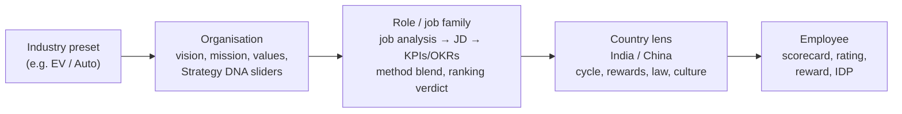
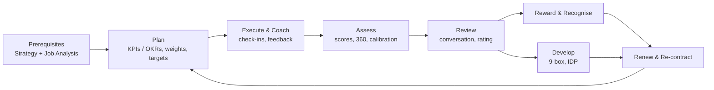
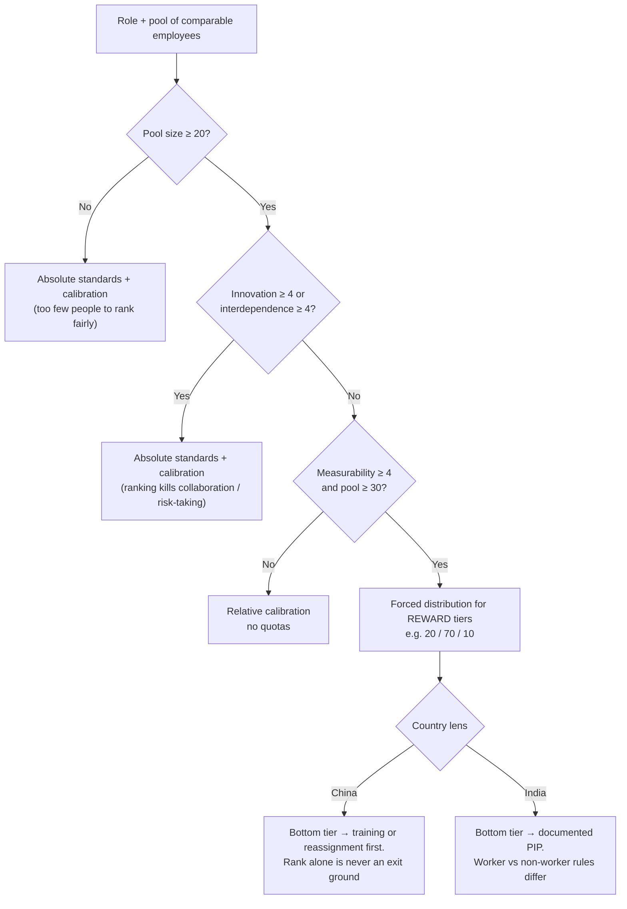
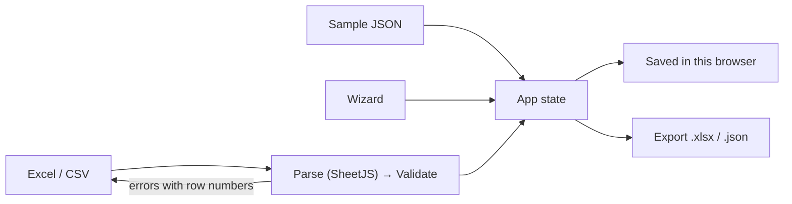

> **Frozen snapshot: README v0.1 (2026-11-18, first brainstorm).** Restored word for word from the chat history on 2026-11-19, after later edits had overwritten it. Superseded by v0.2. **Do not edit this file.** The project index is `README.md`; the current spec is the newest file in `docs/versions/`.

---

# PRISM — Performance Management System (working title)

> **This README is the project's memory.** It holds the brief, every decision, the design, the data model, the plan and the change history.
> Anyone (teammate, professor, or a future Claude session) who opens this folder should be able to read this file and know exactly what is going on.
> **Rule:** update §22 (Changelog) and §18 (Decision log) at the end of every work session. Never delete history. Mark old decisions as *superseded* instead.

| Field | Value |
|---|---|
| Project | PMS course project: build a Performance Management System as an online web app that doubles as the live presentation deck |
| Owner | Deshank (MDI Gurgaon, PGDM-HRM 2026–28) + group (members TBD, see §17) |
| Folder | `/Users/goodpc/Claude/PMS/PMS Project` (Deshank's Mac) |
| Current phase | **Phase 0 — Brainstorm & decisions** |
| Version | v0.1 (brainstorm draft) |
| Last updated | 2026-11-18 |
| Next action | Deshank confirms: industry (§5), hosting (§11), deadline & group (§19) |

---

## Table of contents
0. [Quick context for a new session](#0-quick-context-for-a-new-session)
1. [The brief, as given](#1-the-brief-as-given)
2. [How we read the brief (traceability)](#2-how-we-read-the-brief-traceability)
3. [Guiding principles](#3-guiding-principles)
4. [Core concept: one core, many lenses](#4-core-concept-one-core-many-lenses)
5. [Choosing the industry](#5-choosing-the-industry)
6. [Sample organisation: VoltBridge Mobility](#6-sample-organisation-voltbridge-mobility)
7. [Modules (what the app contains)](#7-modules-what-the-app-contains)
8. [Decision engines (the logic under the animations)](#8-decision-engines-the-logic-under-the-animations)
9. [Country lens: India vs China](#9-country-lens-india-vs-china)
10. [Data ingestion & data model](#10-data-ingestion--data-model)
11. [Hosting & deployment](#11-hosting--deployment)
12. [Tech stack](#12-tech-stack)
13. [Visual & motion design](#13-visual--motion-design)
14. [Presentation plan: the app *is* the deck](#14-presentation-plan-the-app-is-the-deck)
15. [Folder / repo structure](#15-folder--repo-structure)
16. [Work plan, MVP vs stretch](#16-work-plan-mvp-vs-stretch)
17. [Team & roles](#17-team--roles)
18. [Decision log](#18-decision-log)
19. [Open questions](#19-open-questions)
20. [Risks & mitigations](#20-risks--mitigations)
21. [Academic anchors & sources](#21-academic-anchors--sources)
22. [Update protocol & changelog](#22-update-protocol--changelog)

---

## 0. Quick context for a new session

- **What we're building:** a web app that is both a working PMS *and* the presentation. A "central PMS" (universal backbone) that branches into smaller, specialised PMSs per **industry → organisation → role → country (India/China)**.
- **What the evaluator should feel:** "this looks like a real product" (appeal is the top priority, as Deshank put it: appeal matters more than function in college projects), backed by logic that holds up under questioning.
- **Countries in scope:** **India and China only.** Germany was considered and dropped (Deshank, 2026-11-18).
- **Industry:** not locked yet. Recommendation is **EV / automotive** with a fictional Sino-Indian company (§5, §6).
- **Hosting:** not locked yet. Recommendation: **GitHub Pages as the official link + optional Claude-artifact mirror** for AI/live-audience extras (§11).
- **Data:** built-in sample org + Excel template upload + quick-setup wizard (§10).
- **Tools on Deshank's machine Claude can use:** files in this folder; Blender is connected (for 3D/landing assets); built-in browser for previews.
- **House rules:** avoid India/China map outlines (border-depiction sensitivity; use flags or landmark icons). Label all sample data as fictional. Verify every legal/statistical claim before it goes on screen (§9 marks each one ✅ checked / ⚠️ to verify).

---

## 1. The brief, as given

From Deshank (2026-11-18), lightly cleaned up, nothing dropped:

1. **KPIs, job analysis, job description and various parameters** must be in the system.
2. **Tools of analysis: traditional or contemporary?** This should depend on the job type and the sector. Includes **rewards & recognition** and **how rewards are delivered**.
3. **Performance, and how to deliver it.**
4. **Consulting and planning** on various things, strictly about performance.
5. **Development plan.** Depends on the organisation and its vision.
6. **Format:** a live deck or web app (treated as the same thing). Online. Idea: push to GitHub and serve it via GitHub Pages so anyone can open the working app.
7. **Pick one industry.**
8. **Forced ranking: keep it or get rid of it?** Some roles in some industries may need it.
9. **Vision and mission** of the sector/company drive the PMS. In a cutthroat industry, decisions are faster and harsher.
10. **Country differences: China vs India only.** A country-level PMS that can be edited.
11. **Architecture idea:** a central deck/PMS; users choose *their industry* (not country) and get smaller PMSs plus different analysis systems, e.g. "trade and training mechanisms" (meaning of "trade" to confirm, §19).
12. **Presentation:** must be appealing. Lots of transitions, Blender, animations and scroll animations. A destruct-out animation on the landing page only, with the rest of the app behaving differently. Cute animations welcome.
13. **Questions asked:** What works best? How to host? Should it be a Claude artifact? How does it take in data (Excel?)? We need sample data and a sample organisation. Go into as much detail as possible.

---

## 2. How we read the brief (traceability)

Every requirement maps to a part of the app, so nothing gets lost.

| # | Requirement | Where it lives in the app | Section |
|---|---|---|---|
| 1 | KPIs, job analysis, JD, parameters | **M2 Job Architecture Studio** + **M3 KPI & OKR Library** | §7 |
| 2 | Traditional vs contemporary tools | **M4 Method Mixer** (appraisal-method selector) | §7, §8.1 |
| 2b | Rewards & recognition + delivery | **M7 Rewards & Recognition** (total rewards, calculators, recognition wall, delivery planner) | §7, §8.4 |
| 3 | Performance & how to deliver it | **M6 Review & Delivery**: check-in cadence, coaching, review conversations, calibration, appeals. Read two ways: how *employees deliver* performance (execution support) and how *managers deliver* performance feedback | §7 |
| 4 | Consulting & planning (performance only) | **M9 PMS Consultant**: health check, bias detector, rollout plan, risk register, consultant's report | §7 |
| 5 | Development plan tied to org & vision | **M8 Development Studio**: 9-box, IDP, 70-20-10, vision-linked capability map, training mechanisms | §7, §8.5 |
| 6 | Online live deck / web app | Whole app + **Presentation Mode** | §11, §14 |
| 7 | One industry | EV/automotive deep build (recommended), other industries as light presets | §5 |
| 8 | Forced ranking or not | **M5 Ranking Decision Engine**: verdict per role, not per company | §8.2 |
| 9 | Vision/mission drive decisions | **M1 Strategy DNA**: vision, mission, values and pace sliders that change every downstream default | §7 |
| 10 | Editable China vs India PMS | **Country Lens** toggle + editable country config | §9 |
| 11 | Central PMS → smaller PMSs | "One core, many lenses" architecture | §4 |
| 12 | Appeal, animations, Blender | Motion system, Blender pipeline, landing destruct-out | §13 |
| 13 | Hosting, artifact, data ingestion, sample data | Hosting plan, data hub, sample org | §10, §11, §6 |

---

## 3. Guiding principles

1. **Appeal first, but every animation means something.** The shatter shows a central PMS splitting into specialised ones. The country flip shows the same employee under two legal systems. Motion with meaning means the "flashy" criticism doesn't stick.
2. **One core, many lenses.** A single PMS backbone; industry, organisation, role and country *configure* it. That's Deshank's "central PMS + smaller PMSs" idea made concrete.
3. **Decide at the role level, not the company level.** "Forced ranking: yes or no?" and "traditional or contemporary?" get answered *per role*, with the reasons shown.
4. **Strategy drives the system.** Vision, mission and pace come first; KPIs, review cadence, ranking stance, reward mix and development priorities follow from them.
5. **Textbook-defensible.** Built on the Aguinis performance-management process (§21), so every screen maps to a stage the professor recognises.
6. **Works without internet.** Ship a local copy and vendor every library (§12). Venue Wi-Fi can't be trusted.
7. **Fictional but realistic.** A made-up company avoids misrepresenting a real one. Real-company examples appear only as cited "inspiration" callouts.

---

## 4. Core concept: one core, many lenses

### 4.1 The PMS cascade
Configuration flows down like CSS: each layer inherits the one above and can override it.



- **Industry preset** sets defaults: pace, typical roles, KPI library, ranking stance, reward mix.
- **Organisation** overrides with its own vision/mission and *Strategy DNA*: Pace (steady ↔ cutthroat), Innovation, Cost focus, Team orientation, Risk appetite, Customer intimacy (1–10 sliders).
- **Role** adds job analysis, JD, KPIs, method blend and ranking verdict.
- **Country** modifies timing, reward instruments, legal guardrails and feedback norms.
- **Employee** is where it all lands: one scorecard, one rating, one reward, one development plan.

### 4.2 The performance cycle (the app's navigation spine)
Adapted from Aguinis's performance-management process:



The landing page's "split into modules" moment reveals these stages as the menu.

### 4.3 What "central PMS + smaller PMSs" means in practice
- **Central PMS** = the engine (scoring, ranking rules, reward maths, 9-box, consulting logic) plus the cycle above. Same for everyone.
- **Smaller PMSs** = generated configurations: e.g. "EV › VoltBridge › Sales Consultant › China". Each has its own KPIs, method blend, cadence, reward plan and IDP options.
- **Analysis systems** plug in per configuration: rating analytics, bias detection, reward simulation, training-need analysis, ranking feasibility.
- A visitor picks **their industry** in a wizard (as Deshank wanted: industry, not country) and gets a starter PMS. Country is a toggle inside it.

---

## 5. Choosing the industry

### 5.1 What makes a good pick
- **Role diversity:** we need some roles where forced ranking makes sense and some where it clearly doesn't, plus both traditional and contemporary methods.
- **Real India–China story:** the country lens should feel natural, not bolted on.
- **Pace:** a visibly cutthroat industry makes the "vision drives decisions" point land.
- **Visual potential:** something that looks good in 3D/animation.
- **Our domain knowledge.**

### 5.2 Options compared

| Option | Role diversity | India–China story | Cutthroat? | Visual potential | Notes |
|---|---|---|---|---|---|
| **A. EV / automotive** (recommended) | Line technicians, battery R&D, software, showroom sales, charging techs, support, supply chain | Very strong: Chinese EV makers expanding abroad, Indian EV push, real Sino-Indian JVs exist | **Extreme.** China's EV price war led Beijing to campaign against "involution" (*neijuan*), i.e. excessive, self-destructive competition (✅ checked 2026-11-18) | Car "exploded view", batteries, charging | Deshank's TVS RiDE (mobility workforce) case-comp research is reusable |
| B. Consumer electronics / smartphones | Line operators, R&D, retail promoters, online sales | Very strong: Chinese brands make and sell heavily in India | High (thin margins, launch cycles) | Phone teardown | Deshank's Amber Enterprises (electronics manufacturing) experience fits |
| C. Quick commerce / e-commerce | Dark-store ops, riders, category managers, tech | Medium | Extreme | Fast, playful | Riders are gig workers, not employees, so the PMS gets murky |
| D. IT services | Developers, delivery managers, sales | Weak (India-heavy) | Medium | Low | Overdone; bell-curve debate already familiar |

### 5.3 Recommendation
**Option A: EV / automotive**, built around a **fictional Sino-Indian EV company** (§6). It has the cleanest spread of roles across the ranking spectrum, the most cutthroat backdrop right now, and a story where the same company runs under two countries' rules, which is exactly what the country toggle needs.

**Other industries** ship as *light presets* (defaults only) to prove the central PMS is industry-agnostic: IT services, FMCG, BFSI, quick commerce, healthcare, public sector/PSU.

> Status: **proposed, awaiting Deshank's confirmation** (D-01 in §18).

---

## 6. Sample organisation: VoltBridge Mobility

> Entirely **fictional**. Names, numbers and people are made up. The app labels it so on screen.

### 6.1 Identity
- **Name:** VoltBridge Mobility (working name; the "bridge" is India ↔ China)
- **Type:** Sino-Indian EV company: 2-wheelers, compact cars, charging network
- **Sites:**
  - Shenzhen (CN): HQ for battery & powertrain R&D
  - Changsha (CN): vehicle plant
  - Pune / Chakan (IN): vehicle plant + India HQ
  - Bengaluru (IN): vehicle-software centre
  - Sales & service networks in Indian metros and Chinese tier-1/2 cities
- **Vision:** "Make clean mobility the obvious choice for Asia's next billion commuters."
- **Mission:** "Design, build and service affordable, safe EVs and charging. Engineered in Shenzhen and Bengaluru, built in Pune and Changsha, supported wherever our customers drive."
- **Values: SPARK.** **S**peed · **P**recision (safety & quality) · **A**ccountability · **R**espect across cultures · **K**aizen (continuous learning)
- **Strategy DNA (1–10):** Pace **9** (price-war market) · Cost focus **8** · Innovation **7** · Customer intimacy **7** · Team orientation **6** · Risk appetite **6**

### 6.2 Strategic objectives (Balanced Scorecard, fictional targets)
- **Financial:** positive unit economics on core models by FY28; warranty cost < 2% of revenue
- **Customer:** NPS ≥ 50; delivery within 14 days of booking; charger uptime ≥ 98%
- **Internal process:** first-pass yield ≥ 95%; zero lost-time injuries; OTA release crash-free rate ≥ 99.5%
- **Learning & growth:** 40% of technical roles hold a certified EV/high-voltage skill; 50% of manager vacancies filled internally; one cross-border rotation per 20 high-potentials per year

### 6.3 Job families & sample headcount (~250)

| Code | Role | Family | Sites | n (IN + CN) |
|---|---|---|---|---|
| ASM | Assembly Line Technician | Manufacturing | Pune, Changsha | 40 + 30 |
| QIN | Quality Inspector | Manufacturing | Pune, Changsha | 6 + 6 |
| BRD | Battery Cell R&D Engineer | R&D | Shenzhen | 0 + 18 |
| SWE | Vehicle Software Engineer | R&D | Bengaluru | 16 + 0 |
| SAL | EV Sales Consultant | Sales | Metros / tier-1–2 cities | 32 + 34 |
| CSA | Customer Support Associate | Service | Pune, Shenzhen | 24 + 8 |
| CFT | Charging Field Technician | Service | Both | 10 + 8 |
| SCM | Supply Chain Manager | Operations | Pune, Shenzhen | 3 + 3 |
| PLM | People Manager (plant/sales/service) | Leadership | All | 8 + 6 |
| EXE | Leadership team | Leadership | — | 4 |

The pool sizes are deliberate. The Customer Support pools (24 in India, 8 in China) show the ranking engine refusing forced distribution when a pool is too small (§8.2).

### 6.4 Sample KPIs (weights sum to 100 per role)
- **ASM, Assembly Technician:** Units per labour-hour vs standard 30 · First-pass yield 25 · Safety (incidents ↓, near-miss reports ↑) 20 · Kaizen ideas implemented 15 · Attendance/punctuality 10. *Behaviours via BARS: discipline, teamwork.*
- **QIN, Quality Inspector:** Defect escape rate ↓ 35 · Audit compliance 25 · Root-cause reports closed 20 · Inspection throughput 20
- **BRD, Battery R&D (OKRs):** O1 "Next-gen cell pilot-ready": KR energy density target, KR cycle life ≥ target, KR cost/kWh −12%. O2 "Knowledge flows across borders": KR 2 joint papers/patents with Bengaluru, KR 4 tech talks. *Plus 360 on collaboration.*
- **SWE, Software Engineer (OKRs):** OTA crash-free rate ≥ 99.5% · Sprint predictability · Critical vulnerabilities closed within SLA · Peer-review quality
- **SAL, Sales Consultant:** Units vs target 35 · Test-drive → booking conversion 20 · Customer NPS 15 · Finance/insurance attach 10 · Cancellations ↓ 10 · CRM hygiene 10
- **CSA, Customer Support:** CSAT 30 · First-contact resolution 25 · QA audit 20 · Average handle time ↓ 15 · Escalations ↓ 10
- **CFT, Charging Technician:** Territory uptime 35 · Mean time to repair ↓ 25 · First-time fix 20 · HV safety compliance 10 · Customer rating 10
- **SCM, Supply Chain:** Supplier OTIF 25 · Savings vs budget 25 · Inventory days ↓ 20 · Supplier quality PPM ↓ 15 · Dual-sourcing coverage 15
- **PLM, People Manager:** Team KPI attainment 40 · Safety 15 · eNPS 15 · Regretted attrition ↓ 15 · IDPs completed 15. *Plus 360 leadership.*

### 6.5 Personas / storylines planted in the data
These six people carry the demo. Each one shows a concept on screen.

| Persona | Role, site | Story it tells |
|---|---|---|
| **Ritu Deshmukh** | Line Lead, Pune | Output on target but a safety near-miss. Why line roles get absolute standards + team gainsharing, never ranking |
| **Zhang Wei** | Battery R&D, Shenzhen | Hit 0.7 on a stretch OKR, which is *good* in OKR terms. A forced ranking would have punished the ambition. Patent bonus |
| **Arjun Mehta** | Sales Consultant, Bengaluru | Top 5% on the leaderboard → bonus tier 1, "Club" trip, 9-box *future star* → development toward sales manager |
| **Chen Jing** | Sales Consultant, Chengdu | Bottom 10% of pool. Flip the country lens: in China, low rank alone is not a lawful ground for dismissal, so the path is training/reassignment. In India, the same data → documented PIP |
| **Vikram Rao** | Service Manager, Pune | Rates his whole team ~4.6/5 → bias detector flags leniency → calibration session |
| **Wang Fang** | Customer Support, Shenzhen | Her pool has 8 people → ranking engine refuses forced distribution ("pool too small to rank fairly") |

---

## 7. Modules (what the app contains)

Each module lists: **purpose → inputs → logic → outputs → signature visual/animation.**

### M0. Landing & Lens Picker
- **Purpose:** the hook; then "choose your industry".
- **Visual:** a glass prism (the PMS core) is hit by a beam of light. On scroll it **shatters** (destruct-out) and the shards fly into place as the module cards (§13.2).
- **Then:** industry picker. EV/Auto is fully built (★); the other presets are light. Two buttons: "Explore VoltBridge (sample)" or "Set up my organisation" (wizard).

### M1. Strategy DNA (organisation setup)
- **Inputs:** vision, mission, values, BSC objectives, Strategy DNA sliders, operating countries.
- **Logic:** sliders shift downstream defaults. Example: Pace ≥ 8 → monthly check-ins, quarterly reviews, higher variable-pay share, PIP 45–60 days. Pace ≤ 3 → semi-annual reviews, longer development horizons.
- **Outputs:** "Your PMS personality" summary; goal cascade (vision → BSC objectives → department goals → role KPIs).
- **Visual:** animated goal-cascade tree; sliders that visibly reshape a "personality" radar.

### M2. Job Architecture Studio (job analysis → JD → specification)
- **Inputs per role:** job-analysis method used (interview, observation, questionnaire/PAQ, critical incidents, functional job analysis, O*NET reference); purpose; responsibilities; KSAOs; reporting line; grade.
- **Role profile scores (1–5):** output measurability, task interdependence, work standardisation, innovation need, talent supply, digital access, seniority. These feed M4 and M5.
- **Outputs:** generated **JD card** and **job specification**; competency profile.
- **Visual:** role cards that **flip** (front: JD, back: KPIs and profile radar).

### M3. KPI & OKR Library
- **Fields:** KRA, KPI, unit, polarity (higher/lower is better), weight, threshold / target / stretch, frequency, data source, type (KPI / OKR key result / behaviour).
- **Checks:** weights = 100; SMART checker; KPI-vs-OKR guidance (KPIs = run the business; OKRs = change the business).
- **Visual:** draggable weight "pie" that re-balances live.

### M4. Method Mixer: traditional vs contemporary
- **Answers:** "Which appraisal tools fit this role, and in what blend?"
- **Methods:**
  - *Traditional:* graphic rating scale, ranking / paired comparison, forced distribution, checklist, critical incident, essay, BARS, MBO, confidential report (ACR/APAR in public sector)
  - *Contemporary:* KPI scorecards, Balanced Scorecard, OKRs, 360°, continuous check-ins, real-time gamified dashboards, competency/skills-based assessment, people analytics
- **Logic:** §8.1. Each method has fit conditions scored against the role profile + Strategy DNA + country.
- **Output:** top methods with % blend and plain-English reasons, e.g. Assembly Technician: KPI scorecard 50 / BARS 30 / safety checklist 20 → *"Traditional-heavy, because the work is standardised and observable."*
- **Visual:** an **audio-mixer board** with one fader per method (cute + memorable). Faders slide into position; the user can override.

### M5. Ranking Decision Engine
- **Answers:** "Forced ranking for this role: yes, no, or only for calibration?"
- **Verdicts:** (a) **forced distribution for reward tiers**, (b) **relative calibration, no quotas**, (c) **absolute standards**.
- **Logic:** §8.2, including pool size, collaboration, innovation, measurability, pace and the country's legal guardrails.
- **Visual:** animated decision tree lights the path taken. A distribution chart overlays the role's actual scores on a bell curve and a power-law curve (O'Boyle & Aguinis "best and the rest" argument, §21).

### M6. Review & Delivery (requirement #3)
- **Execution side (how employees deliver performance):** check-in cadence set by pace and role; resources/blockers log; mid-cycle goal re-contracting.
- **Feedback side (how managers deliver performance messages):**
  - **Conversation Builder** using SBI (Situation–Behaviour–Impact), GROW coaching and feed-forward. Country-aware tips, e.g. China: critical feedback privately, protect *mianzi* (face)
  - **Calibration Board:** drag employees between rating boxes (GSAP Draggable + Flip)
  - **Review calendar** per country (§9)
  - **Appeals / grievance path**
- **Visual:** timeline of the year that morphs when the country flips; draggable calibration cards.

### M7. Rewards & Recognition (requirement #2b)
- **Total-rewards wheel:** pay, variable pay, benefits, recognition, development, well-being.
- **Calculators (§8.4):** merit-increment matrix (rating × compa-ratio), bonus = target % × company factor × individual multiplier, sales commission/tiers, team gainsharing for plants, patent bonus for R&D.
- **Recognition wall:** peer kudos feed, badges (e.g. "Safety Streak 100 days"), points.
- **Delivery planner, i.e. how rewards are delivered:** *what* (instrument), *when* (cycle/festival timing), *how* (public vs private, cash vs non-cash), *who* (manager, peer, leadership), per country.
- **Visual:** confetti burst on payout; coins flowing into a jar for the bonus pool; budget gauge.

### M8. Development Studio (requirement #5)
- **9-box** (performance × potential) with tracks:
  - *Accelerate* (stars): stretch projects, cross-border rotation Shenzhen ↔ Pune
  - *Grow* (core): certifications, mentoring
  - *Specialist* (high performance, lower potential appetite): expert ladder
  - *Stabilise* (low): coaching / PIP
- **IDP builder** with 70-20-10 (experience / exposure / education).
- **Vision-linked capability map:** VoltBridge's vision → required capabilities (cell chemistry, power electronics, OTA software, consultative EV selling, high-voltage safety, India–China collaboration) → gaps → training.
- **Training mechanisms:** on-the-job training, apprenticeships (India NAPS; China's enterprise apprenticeship schemes, ⚠️ verify), e-learning, HV-safety certification, job rotation, mentoring, Mandarin/English for cross-border teams, skill-based pay levels L1–L4 for line technicians.
- **Visual:** 9-box tiles that fill as employees drop in; an IDP "journey path" that draws itself on scroll.

### M9. PMS Consultant (requirement #4)
- **Health check:** ~12 questions across 6 dimensions (strategic alignment, goal clarity, feedback frequency, fairness/calibration, reward linkage, development linkage) → maturity level 1–5 → radar + prioritised recommendations.
- **Rater-bias detector:** leniency (manager mean > org mean + 0.5), severity, central tendency (SD < 0.4), halo (competency scores correlate > 0.9), recency (last-quarter overweighting).
- **Rollout plan:** pilot → train raters → launch → first calibration → review (Gantt-style), with a change-management lens (ADKAR or Kotter).
- **Risk register** + **Consultant's Report** (one-page summary; PDF export where the host allows).
- **Optional AI consultant** (Claude-artifact version only): "ask the consultant" about the loaded org (§11).

### M10. Country Lens (India ↔ China)
- Header toggle; every module re-renders. A **"what changed"** side panel lists each difference.
- **Editable country config** (form + JSON): cycle timing, reward instruments, legal guardrails, feedback norms, privacy rules (§9).

### M11. Data Hub
- Load sample org · upload Excel/CSV · download template · validate · export back to Excel/JSON · optional live Google Sheet (§10).

### M12. Analytics Dashboard
- Rating distribution, KPI attainment by department/site, 9-box population, reward budget vs payout, top-talent flight risk, calibration shifts, India vs China comparison.

---

## 8. Decision engines (the logic under the animations)

All rules live in JSON so they can be edited and explained. Numbers are starting points to tune.

### 8.1 Method Mixer rules (traditional ↔ contemporary)
Role profile: **M**easurability, **I**nterdependence, **S**tandardisation, **N**ovelty/innovation, **D**igital access, **L**evel (seniority), each 1–5. Plus org **Pace (K)** and country.

| Method | Fits when | Weak when |
|---|---|---|
| KPI scorecard | M ≥ 4 | M ≤ 2 |
| Checklist / BARS | S ≥ 4, behaviours observable | N ≥ 4 |
| Critical incident | Supervisor observes closely; safety-critical work | Large spans of control |
| Ranking / forced distribution | See §8.2 only | — |
| MBO | L ≥ 3, clear annual objectives | Fast-changing goals (K ≥ 8) |
| Balanced Scorecard | L ≥ 4, cross-functional roles | Individual contributors |
| OKRs | N ≥ 4, ambitious goals, transparency | S ≥ 4 routine work |
| 360° | L ≥ 3 or I ≥ 4; needs trust | Low trust; in high power-distance cultures keep it **anonymous** |
| Continuous check-ins | K ≥ 7 or N ≥ 4 | Very stable work |
| Gamified real-time dashboard | M ≥ 4, high volume, D ≥ 3 | I ≥ 4 |
| Confidential report (ACR/APAR) | Public-sector preset only (shown as the "traditional baseline") | Everywhere else |

Output = normalised fit scores → top 3 → % blend → a "Traditional ↔ Contemporary" index for the role.

**Expected VoltBridge results:**
- Assembly/Quality → traditional-heavy
- R&D/Software → contemporary
- Sales/Support → hybrid (traditional ranking + contemporary real-time dashboards)
- Managers → BSC + 360

### 8.2 Ranking Decision Engine



**Pace modifier:** cutthroat (K ≥ 8) tightens tiers (e.g. 15/75/10) and shortens cycles; it never removes legal guardrails or the PIP step.

**Why role-level?** The debate is live again in 2025–26. Microsoft gave low performers a choice: leave with 16 weeks' pay or go on a PIP. Meta and Amazon moved back toward quota-based ratings. HR bodies warn about the side effects (silo-ing, damaged morale). Our engine shows *where* ranking is defensible and where it isn't (✅ checked 2026-11-18; sources in §21).

**Expected VoltBridge verdicts:**
- Sales India & China → **forced distribution for bonus tiers**. In China, the bottom tier gets training/reassignment
- Customer Support India (24) → **relative calibration**. China (8) → **absolute** (pool too small)
- Assembly, Quality, Charging Tech → **absolute standards + team gainsharing**
- Battery R&D, Software → **absolute + calibration** (innovation)
- Supply Chain, Managers → **relative calibration**

### 8.3 Scoring
- **KPI attainment → 1–5:** linear between threshold (1), target (3) and stretch (5); polarity flips for "lower is better"; capped at 5.
- **OKR score 0–1.0 → rating:** 0.7 counts as "met" (≈ 3.5); 1.0 suggests the goal wasn't stretching enough (flagged).
- **Composite:** *What* (results) × weight + *How* (behaviours/competencies) × weight. Defaults: 70/30 for ops & sales, 50/50 for R&D & managers.
- **Rating labels (5-point, editable):** 1 Unsatisfactory · 2 Developing · 3 Solid · 4 Strong · 5 Outstanding. Each has BARS anchors.

### 8.4 Rewards maths (editable placeholders: real budgets to be sourced)
- **Merit increment** = merit matrix [rating × compa-ratio band] × country merit budget. Compa-ratio bands: < 0.9, 0.9–1.1, > 1.1.
- **Annual bonus** = base × target bonus % (by grade) × company performance factor (0–1.5) × individual multiplier. Multipliers: 1 → 0 · 2 → 0.5 · 3 → 1.0 · 4 → 1.25 · 5 → 1.5.
- **Sales:** monthly commission per unit + tier kicker for the top 20% + quarterly contest.
- **Plants:** team gainsharing pool = share of productivity savings vs standard, split by attendance-adjusted hours.
- **R&D:** patent filing/grant bonus + equity for key talent.
- **Budget guard:** total payout vs pool shown on a gauge; the simulator rescales if it is breached.

### 8.5 Development logic
- **Performance axis** = composite rating. **Potential axis** = manager + calibration input (1–3).
- Box → track (Accelerate / Grow / Specialist / Stabilise) → suggested 70-20-10 actions drawn from the training catalogue. Actions are weighted toward the **vision-linked capability gaps** of that role.

---

## 9. Country lens: India vs China

Every row is a field in the editable country config. Status: ✅ = checked against sources this session; ⚠️ = verify before it goes on screen.

| Parameter | India | China | Status |
|---|---|---|---|
| Performance year | April–March financial year; reviews ~Mar–May; increments from Apr (or Jul) | Calendar year; reviews ~Dec–Jan, before Spring Festival | ⚠️ common practice, confirm with examples |
| Year-end reward instrument | Annual variable pay; statutory bonus under the Code on Wages (8.33%–20% for eligible employees); festive (Diwali) bonus/gifts; ESOPs in startups | Year-end bonus / "13th-month" pay before Spring Festival; red-packet (*hongbao*) spot awards; equity for key talent | ⚠️ |
| Mandatory, non-performance pay | PF, gratuity, ESI (Social Security Code) | Social insurance + housing provident fund | ⚠️ |
| Labour-law frame | Four Labour Codes in force since **21 Nov 2025** (Wages, Industrial Relations, Social Security, OSH), replacing 29 laws. Central rules notified in 2026 | Labour Contract Law (2008) | ✅ India dates |
| Performance-based exit | Needs a documented process; "worker" vs managerial/supervisory staff treated differently; retrenchment without government approval now allowed for firms up to 299 workers (IR Code) | **Art. 40(2):** "incompetent" employee must be trained or reassigned first, and still be incompetent, before termination. **SPC Guiding Case No. 18 (2013, ZTE Hangzhou v. Wang Peng):** a low ranking *alone* is not a lawful ground; ranking may still adjust role or pay | ✅ China case; ⚠️ fine print |
| Making PMS rules | Standing orders for establishments above the IR Code threshold | Rules affecting employees' vital interests need democratic consultation and must be published (LCL Art. 4) | ⚠️ |
| Working-hours guardrail for "cutthroat pace" | OSH Code weekly-hours cap | "996" schedules found unlawful in 2021 typical cases | ⚠️ |
| Employee-data privacy | DPDP Act 2023 (rules phasing in) | PIPL; the March 2024 cross-border data rules **exempt employee data transfers needed for cross-border HR management**, which matters for a central India–China PMS database | ✅ China exemption; ⚠️ DPDP status |
| Feedback culture | Hierarchy-sensitive; relationship-driven; manager-as-mentor; public praise welcome | High power distance; collectivist; *mianzi* (face) → critical feedback in private, praise at team level; *guanxi* matters | ⚠️ cite Hofstede / literature |
| 360° design | Anonymous upward feedback recommended | Anonymous upward feedback strongly recommended; peer rating framed as team contribution | — |
| Public-sector baseline | APAR (formerly ACR) | Civil-service appraisal on morality, ability, diligence, achievement, integrity (德能勤绩廉) | ⚠️ |
| Recognition norms | Town-hall awards, family-inclusive events, festival contests | Honorary titles ("model worker"), team banners, red packets | ⚠️ |

**Demo moment:** select Chen Jing → flip India ↔ China → the year timeline, bonus instrument, bottom-tier action and feedback script all morph, and the "what changed" panel lists each difference.

---

## 10. Data ingestion & data model

### 10.1 Three ways in (all run in the browser; no data leaves the device)
1. **Built-in sample org** (VoltBridge JSON) loads by default, so the demo always works offline.
2. **Excel/CSV upload** using a downloadable template. Parsed in-browser with SheetJS → validated → previewed → committed. (Talking point: privacy by design, nothing is uploaded to a server.)
3. **Quick-setup wizard** for visitors: pick industry → name org → move Strategy DNA sliders → pick roles from the preset library → get a starter PMS.

Optional extra: **live Google Sheet** ("publish to web as CSV" link), so a teammate can edit numbers live during the presentation. Works only on the GitHub Pages build, because Claude artifacts block requests to other sites (§11).



### 10.2 Excel template: `pms_input_template.xlsx` (one sheet per entity)

| Sheet | Key columns |
|---|---|
| `README` | How to fill it; ID rules; allowed values |
| `Org` | org_name, industry, countries, vision, mission, values, pace, innovation, cost_focus, team_orientation, risk_appetite, customer_intimacy, fy_start_month |
| `Departments` | dept_id, dept_name, site, country, head_emp_id |
| `Roles` | role_id, title, job_family, dept_id, grade_band, purpose, responsibilities (`;` separated), knowledge, skills, abilities, other, job_analysis_method, measurability, interdependence, standardisation, innovation, talent_supply, digital_access, seniority (each 1–5) |
| `KPIs` | kpi_id, role_id, kra, kpi_name, type (KPI/KR/Behaviour), unit, polarity, weight_pct, threshold, target, stretch, frequency, data_source |
| `Competencies` | comp_id, name, description, bars_1 … bars_5, role_ids |
| `Employees` | emp_id, name, role_id, dept_id, site, country, manager_id, grade, hire_date, base_pay, currency, pay_range_mid, potential (1–3), flight_risk (L/M/H) |
| `KPI_Actuals` | emp_id, kpi_id, period (e.g. 2026-Q2 or 2026-07), actual |
| `Feedback_360` | ratee_id, rater_code (anonymised), relationship (self/manager/peer/report/customer), comp_id, score, comment |
| `CheckIns` | emp_id, date, type (1:1 / coaching / recognition / goal change), note |
| `Reward_Policy` | country, grade, target_bonus_pct, merit_budget_pct, rating, multiplier, compa_band, merit_pct |
| `Recognition` | from_emp_id, to_emp_id, date, badge, points, message |
| `Training_Catalogue` | course_id, capability, mode (OJT / e-learning / classroom / rotation / mentoring / apprenticeship), duration_hrs, cost, bucket_70_20_10 |
| `Country_Config` | key, india_value, china_value, note |

**Validation rules:** required columns present; IDs unique and resolvable (role_id, manager_id…); weights per role = 100; scores within range; threshold < target < stretch (or reversed for "lower is better"); dates parse; currencies INR/CNY.

### 10.3 Sample data generation
- A seeded Python script (`scripts/generate_sample_data.py`) produces ~250 employees × 4 quarters of KPI actuals + 360 data for R&D/managers. It writes **both** `data/sample-org/voltbridge.json` and `data/templates/voltbridge_filled.xlsx`.
- Performance drawn from a **skewed (power-law-like) distribution**, not a neat bell, so M5's "bell vs best-and-the-rest" chart has something to show.
- Personas from §6.5 are injected with fixed values so the storylines always appear.
- Names drawn from Indian and Chinese name lists; every file is labelled "fictional".

---

## 11. Hosting & deployment

### 11.1 Options

| | GitHub Pages | Claude artifact | Vercel / Netlify |
|---|---|---|---|
| Cost | Free (public repo; private-repo Pages needs a paid plan, often free via GitHub Education ⚠️) | Part of the Claude plan | Free tier |
| Who can open it | Anyone with the link, no login | Private until shared from claude.ai; can be shared publicly | Anyone |
| Backend / AI | None: static only. Never put an API key in it | Can **ask Claude** from the page (AI consultant, JD drafts), run a **live room** (audience presence/polls), keep **shared data**. These light up only where Claude lets them run (likely you and invited people); everyone else gets the page without them | Serverless functions possible (needs your own API key/billing) |
| Restrictions | None | Scripts only from approved CDNs (cdnjs, jsDelivr, unpkg…) or our own files; no remote images; downloads/print need a declared capability; no requests to other sites | None |
| Versioning / teamwork | Git history, pull requests, teammates can contribute | Artifact versions; editing goes through Claude | Git |
| Offline backup | Run the same folder locally | No | No |
| Credibility | "We shipped a product", code visible | "Built with Claude" | Same as Pages |

### 11.2 Recommendation (proposed, D-02)
**Build once, deploy twice, from this folder:**
1. **GitHub Pages = the official link** for the professor and anyone else. No login, no limits, and it shows real engineering.
2. **Claude artifact = fast preview while building + an optional "Claude edition"** that adds the AI consultant (M9) and a live audience poll during the presentation (§14). The code checks whether those features are available and quietly hides them when they aren't, so **the same files run on both hosts**.
3. **Local copy on the presenting laptop** (`python3 -m http.server` in the folder) as the no-internet fallback.

To keep one codebase valid on both hosts, follow the artifact rules everywhere: libraries vendored as our own files or loaded from approved CDNs; images, 3D models and frames shipped as our own files; no calls to outside sites except the optional Google-Sheet feature (Pages only).

### 11.3 About "two pages"
Read as **GitHub Pages**. It also works literally: the experience has **two parts**, a cinematic landing (destruct-out) and the working app. Confirm (§19).

---

## 12. Tech stack (proposed)

| Need | Choice | Why |
|---|---|---|
| Structure | Plain HTML + ES modules, **no build step** | Runs on GitHub Pages and as an artifact as-is; easy for teammates |
| UI components | Preact + htm (React-style without a build) or vanilla + a tiny store | Re-render everything on the country toggle without a framework build |
| Motion | **GSAP**: ScrollTrigger, SplitText, Flip, Draggable, MorphSVG, DrawSVG | Since Webflow's backing, all GSAP plugins are free, including formerly paid ones like SplitText and MorphSVG (✅ checked) |
| Smooth scroll | Lenis | Buttery scroll for scroll-scrubbed scenes |
| 3D | Three.js (+ GLTFLoader, Draco) | Landing prism shatter / EV exploded view |
| 3D asset creation | **Blender** (connected on Deshank's machine): Cell Fracture → rigid-body sim → bake to keyframes → export GLB | Real physics shatter; driven by scroll in Three.js |
| Charts | Apache ECharts | Animated radar, heatmap, gauge, tree, sankey out of the box |
| Excel | SheetJS (vendored recent community build, not the outdated CDN version) | Read/write .xlsx in the browser |
| Micro-animations | Lottie (own or properly licensed files), canvas-confetti | Cute moments: badges, confetti, mascot |
| Fonts | Google Fonts (allowed on both hosts) | e.g. a display face for headlines + Inter/Manrope for UI |
| Data | JSON presets + sample org; localStorage per browser | No server needed |

---

## 13. Visual & motion design

### 13.1 Look & feel (to be refined in design)
- Dark, cinematic landing → bright, airy app (the "other part works differently" contrast Deshank asked for).
- Accent palette from the prism split: each module gets one spectral colour, used consistently in its charts and cards.
- Country accents: subtle saffron/green for India, red/gold for China. Use **flags or landmark icons, never map outlines** (border depictions are politically sensitive).

### 13.2 Landing: "The Prism" destruct-out (recommended)
1. Black screen; a single beam of light; a glass prism fades in. Title "PRISM" types in with a SplitText scramble.
2. Scroll 0–30%: the beam hits the prism and splits into the spectrum. Each colour band is labelled with a cycle stage (§4.2).
3. Scroll 30–60%: the prism **shatters** (Blender-baked fracture). Shards drift in slow motion.
4. Scroll 60–100%: shards fly to the grid and morph into module cards (GSAP Flip). The background brightens into the app.
- **Alternative:** "Exploded EV". A compact EV disassembles into labelled parts: battery = KPIs (energy), motor = rewards (drive), chassis = job architecture, steering = development (direction), dashboard = analytics. Could open the VoltBridge sample after the prism landing.

### 13.3 In-app motion vocabulary
- Section transitions: clip-path wipes in the module's colour; pinned scroll-story sections for the framework explanation (cycle drawn with DrawSVG).
- Cards: flip (JD ↔ KPIs), tilt on hover, magnetic buttons.
- Numbers count up; charts animate in when scrolled into view.
- Country flip: a 3D card-flip of the whole header, then all values morph.
- Cute layer: an original mascot ("Volty", a small battery character) reacts to events: cheers on payouts, sweats on a PIP, sleeps in a too-small ranking pool. Confetti on rewards, a badge "pop" on recognition.

### 13.4 Performance & accessibility
- Respect `prefers-reduced-motion`; a **Lite mode** toggle for weak projector laptops.
- 3D budget: GLB under ~3 MB, Draco-compressed; a 2D SVG fallback if WebGL fails.
- Test on the actual presenting laptop and projector, plus a phone.

---

## 14. Presentation plan: the app *is* the deck

### 14.1 Presentation Mode
Arrow keys step through **chapters** (scroll-snapped sections), with a progress bar, a speaker-notes toggle (hidden from the projector), and a "jump to persona" palette.

### 14.2 Draft chapter flow (timing TBD with the slot length)
1. **Hook:** prism landing destruct-out (30 s)
2. **Why PMS fails:** 2–3 sourced stats (to source)
3. **Our framework:** one core, many lenses + the cycle
4. **Choose your lens:** industry picker → VoltBridge
5. **Strategy DNA:** vision/mission → cascade; move Pace to 9 and watch the defaults change
6. **Job Architecture → KPIs:** flip Ritu's card
7. **Method Mixer:** assembly vs R&D faders (traditional vs contemporary)
8. **Forced ranking verdicts:** Sales yes (reward tiers), R&D no, Support China "pool too small"
9. **Review & delivery:** conversation builder; calibration board with Vikram's leniency flag
10. **Rewards:** bonus simulator, recognition wall, confetti
11. **Country flip:** Chen Jing India ↔ China
12. **Development:** 9-box → Arjun's IDP → cross-border rotation
13. **Consultant's report:** health-check radar + rollout plan
14. **Close + Q&A:** optional live audience poll ("Would you keep forced ranking for sales?") via the artifact's live room

### 14.3 Fallbacks
Local copy; a recorded screen capture of the full run; static PDF of key screens.

---

## 15. Folder / repo structure (planned)

```
PMS Project/
├── README.md                  ← this file (project memory)
├── index.html                 ← app entry (GitHub Pages serves this)
├── css/
│   └── main.css
├── js/
│   ├── main.js                ← boot, routing (#hash views), presentation mode
│   ├── store.js               ← app state, localStorage, import/export
│   ├── engine/
│   │   ├── scoring.js         ← §8.3
│   │   ├── methods.js         ← §8.1 Method Mixer rules
│   │   ├── ranking.js         ← §8.2 Ranking engine
│   │   ├── rewards.js         ← §8.4
│   │   ├── development.js     ← §8.5
│   │   ├── bias.js            ← M9 bias detector
│   │   └── country.js         ← §9 lens application
│   ├── modules/               ← one file per M0–M12 screen
│   └── anim/
│       ├── landing.js         ← prism / shatter scene
│       └── transitions.js
├── data/
│   ├── presets/industries/    ← ev-auto.json (full), it-services.json, fmcg.json, …
│   ├── presets/countries/     ← india.json, china.json
│   ├── rules/                 ← methods.json, ranking.json, rewards.json
│   ├── sample-org/            ← voltbridge.json
│   └── templates/             ← pms_input_template.xlsx, voltbridge_filled.xlsx
├── assets/
│   ├── 3d/                    ← prism_shatter.glb, ev_exploded.glb
│   ├── lottie/
│   └── img/
├── vendor/                    ← gsap, three, echarts, sheetjs, lenis (offline-safe)
├── blender/                   ← .blend sources + export scripts
└── scripts/
    └── generate_sample_data.py
```

---

## 16. Work plan, MVP vs stretch

### 16.1 Phases (dates once the deadline is known)

| Phase | Output | Done when |
|---|---|---|
| 0. Decide | Industry, hosting, name, scope locked | §18 D-01…D-04 marked *decided* |
| 1. Content & rules | Presets, KPI library, country config, rule JSONs | Every §7 module has its data |
| 2. Sample data | VoltBridge JSON + Excel template + filled workbook | Personas visible in the data |
| 3. Engine + Data Hub | Scoring, ranking, rewards, bias, import/export | Upload → validate → results work |
| 4. Module screens | M1–M12 functional | Full demo path clickable |
| 5. Motion & 3D | Landing shatter, transitions, cute layer | Runs smoothly on the presenting laptop |
| 6. Presentation | Presentation mode, script, notes, Q&A prep | Two full rehearsals |
| 7. Ship | GitHub Pages live, artifact mirror, offline copy, backup video | Link shared |

### 16.2 MVP (must have for presentation day)
- Landing animation (2D/SVG version is fine at first)
- Industry picker (EV full + 3 light presets)
- VoltBridge sample org; 8 roles with JD + KPIs
- Method Mixer and Ranking Engine with reasons
- Review calendar + Conversation Builder
- Rewards calculator + recognition wall
- 9-box + IDP
- Health check + bias detector
- Country toggle with "what changed"
- Excel template download/upload
- Presentation Mode

### 16.3 Stretch
Blender 3D shatter; EV exploded view; AI consultant (artifact); live audience poll; live Google Sheet; mascot; PDF report; mobile polish.

---

## 17. Team & roles
*(fill in)*

| Member | Roll no. | Owns | Presents |
|---|---|---|---|
| Deshank | 26PGHR079 | Product lead, build & deploy (with Claude) | TBD |
| … | | Content: KPIs/JDs per role | |
| … | | Country lens research (India/China) | |
| … | | Rewards & development content | |
| … | | Presentation script & rehearsal | |

---

## 18. Decision log

| ID | Decision | Status | Date | Notes |
|---|---|---|---|---|
| D-00 | Countries in scope: **India and China only** (Germany dropped) | ✅ Decided (Deshank) | 2026-11-18 | |
| D-00b | Web app = live deck (one artifact serves both) | ✅ Decided (Deshank) | 2026-11-18 | |
| D-00c | Appeal is the top priority; logic must still hold up | ✅ Decided (Deshank) | 2026-11-18 | |
| D-00d | Visitors choose *industry* in the central PMS; country is a lens inside | ✅ Decided (Deshank) | 2026-11-18 | |
| D-01 | Industry = **EV / automotive** with fictional Sino-Indian company "VoltBridge Mobility" | 🟡 Proposed | 2026-11-18 | Runner-up: consumer electronics |
| D-02 | Hosting = **GitHub Pages (official) + Claude artifact mirror (AI/live extras) + offline copy** | 🟡 Proposed | 2026-11-18 | |
| D-03 | Data in = sample JSON + Excel template (in-browser) + wizard; Google Sheet optional | 🟡 Proposed | 2026-11-18 | |
| D-04 | Forced ranking decided **per role** by the Ranking Engine, with country legal guardrails | 🟡 Proposed | 2026-11-18 | |
| D-05 | Working name "PRISM" + prism-shatter landing | 🟡 Proposed | 2026-11-18 | Alt: EV exploded view |
| D-06 | No-build stack: ES modules + GSAP + Three.js + ECharts + SheetJS, all vendored | 🟡 Proposed | 2026-11-18 | |

---

## 19. Open questions (for Deshank / group)
1. **Deadline, slot length and format** (minutes, live demo allowed, Q&A)? Any rubric or must-cover frameworks from the professor?
2. **Group members, roll numbers and who presents what?**
3. **Confirm the industry:** EV (recommended) or consumer electronics?
4. **Fictional company OK,** or does the professor want a real company?
5. **"Two pages":** did you mean GitHub Pages, two literal pages, or both?
6. **"Trade and training mechanisms":** what did "trade" mean? (Grading? Trade apprenticeships for shop-floor roles? Something else?)
7. **Audience interaction:** do we want classmates joining on their phones (live poll)? That pushes toward the artifact edition for that segment.
8. **Branding:** any MDI/course branding requirements, or full creative freedom?
9. **GitHub:** which account hosts the repo? Is a public repo OK?

---

## 20. Risks & mitigations

| Risk | Mitigation |
|---|---|
| Scope creep (13 modules + 3D) | Lock the MVP list (§16.2); stretch items only after the MVP works end-to-end |
| Animation jank on projector laptop | Lite mode; test early on the real machine; 2D fallback for 3D |
| No internet at venue | Vendored libs + local server copy + backup video |
| "Flashy, no substance" | Every animation tied to a concept (§3.1); engine reasons shown on screen |
| Wrong legal/statistical claims | §9 status column; verify every ⚠️ before presenting; add an "illustrative, not legal advice" footer |
| Political sensitivity (India–China) | Fictional company; neutral tone; no map outlines |
| Teammates editing the same files | One maintainer merges; content owners edit JSON/Excel only |
| Data privacy questions | Everything runs in-browser; sample data fictional |

---

## 21. Academic anchors & sources

### 21.1 Frameworks to cite (verify exact editions before the references slide)
- Aguinis, H. *Performance Management* (latest edition): performance-management process; prerequisites → planning → execution → assessment → review → renewal
- O'Boyle, E., & Aguinis, H. (2012). The best and the rest: Revisiting the norm of normality of individual performance. *Personnel Psychology, 65*(1).
- Buckingham, M., & Goodall, A. (2015). Reinventing performance management. *Harvard Business Review.* (Deloitte)
- Cappelli, P., & Tavis, A. (2016). The performance management revolution. *Harvard Business Review.*
- Kaplan, R. S., & Norton, D. P. (1992/1996). Balanced Scorecard.
- Doerr, J. (2018). *Measure What Matters* (OKRs).
- Grote, D. (2005). *Forced Ranking.*
- Hofstede's cultural dimensions (India vs China comparison)
- 70-20-10 learning model (Lombardo & Eichinger); 9-box grid; WorldatWork total rewards model; SBI and GROW feedback models

### 21.2 Sources checked this session (2026-11-18)
- India Labour Codes in force 21 Nov 2025: [Outlook India](https://www.outlookindia.com/national/indias-new-labour-codes-take-effect-all-you-need-to-know) · [HSF Kramer](https://www.hsfkramer.com/ko/notes/employment/2025-posts/india-labour-codes-implemented-a-landmark-reform) · [Lakshmikumaran & Sridharan: central rules 2026](https://employmentlaw.lkslaw.com/what-changed-2025) · [Fox Mandal: 299-worker threshold](https://foxmandal.in/wp-content/uploads/2025/12/New-Labour-Codes-3.pdf)
- China Guiding Case No. 18: [Supreme People's Court](https://www.court.gov.cn/shenpan/xiangqing/6002.html) · [CBL Translations explainer](https://cbltranslations.com/en-us/china-law/employment/legally-terminating-poor-performance-explained/)
- China cross-border data, HR exemption (Mar 2024): [Freshfields](https://riskandcompliance.freshfields.com/post/102j3jy/china-introduces-revised-cross-border-data-transfer-rules) · [Zhong Lun](https://en.zhonglun.com/research/articles/52898.html) · [Seyfarth](https://seyfarth.com/news-insights/practical-insights-from-china-on-the-newly-issued-provisions-on-cross-border-data-transfer.html)
- Forced-ranking revival 2025–26: [LeadDev on Microsoft](https://leaddev.com/?p=25453) · [SHRM: Stack ranking's hidden cost](https://www.shrm.org/enterprise-solutions/insights/stack-ranking-hidden-cost-of-easy-way-out) · [The Work Forward on Meta/Amazon](https://theworkforward.substack.com/p/stop-ranking-start-lifting)
- China EV price war / anti-involution: [CNBC via The Nightly](https://thenightly.com.au/from/cnbc/involution-or-evolution-china-wants-to-stop-the-ev-price-war-but-analysts-are-doubtful-c-18942742) · [Caixin year in review](https://www.caixinglobal.com/2026-01-02/year-in-review-toxic-competition-drives-china-to-rein-in-auto-price-war-102399571.html) · [Automotive World: BYD discounts 2026](https://www.automotiveworld.com/?p=465619)
- GSAP fully free: [GSAP 3.13 release notes](https://gsap.com/blog/3-13/) · [Webflow announcement](https://webflow.com/blog/gsap-becomes-free)

---

## 22. Update protocol & changelog

### 22.1 How to keep this file useful
At the end of every session (human or Claude):
1. Update the status table at the top: phase, version, last updated, next action.
2. Add a changelog line below: date, who, what changed.
3. Move decisions in §18 from 🟡 Proposed to ✅ Decided, or to ❌ Superseded (keep the row and say what replaced it).
4. Tick off answered questions in §19 and move the answer into the relevant section.
5. When a ⚠️ fact in §9 is verified, flip it to ✅ and add the source to §21.2.

### 22.2 Changelog
| Date | By | Change |
|---|---|---|
| 2026-11-18 | Claude (with Deshank) | README created. Brainstorm v0.1: brief captured, architecture ("one core, many lenses"), 13 modules, decision engines, India–China lens, data model & Excel template spec, hosting plan, tech stack, motion plan, presentation flow, sample org VoltBridge with personas, decision log, open questions, risks, sources |
