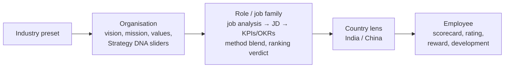
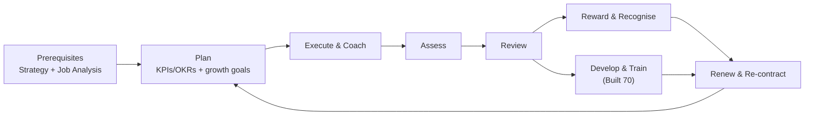
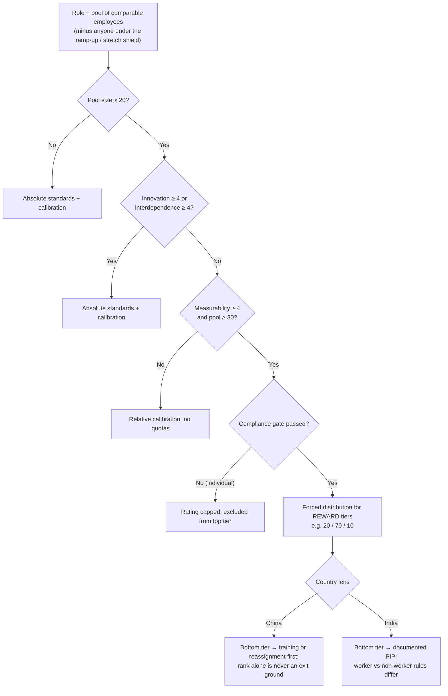
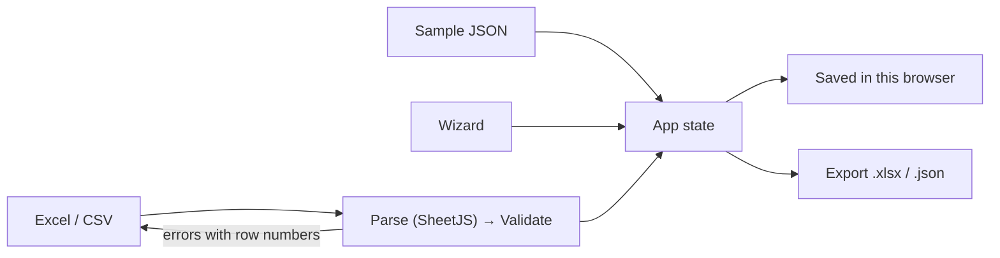

> **Frozen snapshot: README v0.3 (2026-11-18, motion prototype).** Saved unchanged on 2026-11-19 when the docs were split into one file per version. Superseded by v0.4. **Do not edit this file.** The project index is `README.md`; the current spec is the newest file in `docs/versions/`.

---

# PRISM: a Performance Management System you can *see* (working title)

> **This README is the project's memory.** It holds the brief, every decision, the design, the data model, the plan and the change history.
> Anyone (teammate, professor, or a future Claude session) who opens this folder should be able to read this file and know exactly what is going on.
> **Rule:** update §22 (Changelog) and §18 (Decision log) at the end of every work session. Never delete history. Mark old decisions as *superseded* instead.

| Field | Value |
|---|---|
| Project | PMS course project: build a Performance Management System as an online web app (app only, no live presentation) |
| Owner | Deshank (MDI Gurgaon, PGDM-HRM 2026–28) + group (members TBD, see §17) |
| Folder | `/Users/goodpc/Claude/PMS/PMS Project` (Deshank's Mac) |
| Current phase | **Phase 0: Brainstorm & lock decisions** |
| Version | v0.3 |
| Last updated | 2026-11-18 (23:55 IST) |
| Working deadline | **Not confirmed.** Expected in 15–20 days, so we plan to finish by **3 Dec 2026**, with buffer to 8 Dec (§16) |
| Next action | Deshank confirms industry (pharma vs EV, §5) and hosting (§11); asks professor about the India–China expectation (§19) |
| Whiteboard | [PRISM: PMS app plan](https://claude.ai/artifact/XAnkMVKevDwPAjMGCDgWg3) |
| Motion prototype | [PRISM motion lab](https://claude.ai/artifact/XoVf1GTvHF1S45PeWR8hMZ) · files in `prototypes/motion-lab/` (§13.0) |

---

## Table of contents
0. [Quick context for a new session](#0-quick-context-for-a-new-session)
1. [The brief, as given](#1-the-brief-as-given)
2. [How we read the brief (traceability)](#2-how-we-read-the-brief-traceability)
3. [Guiding principles](#3-guiding-principles)
4. [Core concept: one core, many lenses](#4-core-concept-one-core-many-lenses)
5. [Choosing the industry (and not looking like everyone else)](#5-choosing-the-industry-and-not-looking-like-everyone-else)
6. [Sample organisation](#6-sample-organisation)
7. [Modules (what the app contains)](#7-modules-what-the-app-contains)
8. [Decision engines (the logic under the animations)](#8-decision-engines-the-logic-under-the-animations)
9. [Country lens: India vs China](#9-country-lens-india-vs-china)
10. [Data ingestion & data model](#10-data-ingestion--data-model)
11. [Hosting & deployment](#11-hosting--deployment)
12. [Tech stack](#12-tech-stack)
13. [Visual & motion design](#13-visual--motion-design)
14. [Evaluator experience: the app explains itself](#14-evaluator-experience-the-app-explains-itself)
15. [Folder / repo structure](#15-folder--repo-structure)
16. [Work plan: 15-day sprint](#16-work-plan-15-day-sprint)
17. [Team & roles](#17-team--roles)
18. [Decision log](#18-decision-log)
19. [Open questions](#19-open-questions)
20. [Risks & mitigations](#20-risks--mitigations)
21. [Academic anchors & sources](#21-academic-anchors--sources)
22. [Update protocol & changelog](#22-update-protocol--changelog)

---

## 0. Quick context for a new session

- **What we're building:** a web app that *is* a working PMS. A "central PMS" (universal backbone) branches into smaller, specialised PMSs per **industry → organisation → role → country (India/China)**. There is **no live presentation**: the evaluator opens the app and explores it, so it must explain itself (§14).
- **What the evaluator should feel:** "this looks like a real product." Deshank's priority: appeal matters most in college projects. The logic still has to hold up.
- **Signature idea (Deshank, v0.2):** *Born 30 · Built 70.* Twin studies trace ~30% of the variance in who ends up in leadership roles to genes and the rest to experience, so the PMS deliberately leaves room for development. This shows up as the **Leadership Forge** (§7 M8b, §8.6).
- **Countries in scope:** **India and China only.** Germany was dropped. Whether the professor wants India–China *explored* or *built in* is unknown, so the country lens has three modes: Off / Compare / Built-in (§9).
- **Industry:** not locked. v0.2 recommendation: **pharmaceuticals**, with the fictional *Helixa Pharma*. It replaces EV because an EV pick is what other groups' AI tools are most likely to suggest too (§5). EV (*VoltBridge*) stays as the fallback.
- **Hosting:** **GitHub Pages** is the deliverable. A Claude artifact is used only for build previews. The live poll is dropped, and AI features are not worth building, because the evaluator likely couldn't run them (§11).
- **Data:** built-in sample org + Excel template (read in the browser) + quick-setup wizard (§10).
- **Training:** "training mechanisms" (Deshank misspoke "trade"): TNA → training method selector → Kirkpatrick evaluation (§7 M8).
- **Tools on Deshank's machine Claude can use:** this folder; Blender (for 3D/landing assets); built-in browser for previews. His Gmail does not contain the project brief, and the MDI mail connector was not connecting on 2026-11-18.
- **Whiteboard:** visual summary of this README → [PRISM: PMS app plan](https://claude.ai/artifact/XAnkMVKevDwPAjMGCDgWg3) (private to Deshank until shared). Keep it in step with §5, §7, §16, §18 and §19.
- **Motion prototype:** five signature animations already built and tested → [PRISM motion lab](https://claude.ai/artifact/XoVf1GTvHF1S45PeWR8hMZ), source in `prototypes/motion-lab/`. Full motion spec in §13.
- **House rules:** no India/China map outlines (border sensitivity; use flags or landmark icons). Label all sample data fictional. Every legal/statistical claim on screen must be verified (§9 marks ✅ checked / ⚠️ to verify). Never treat the "30% genetic" figure as something we measure about a person (§8.6 ethics).

---

## 1. The brief, as given

### 1.1 Original brief (2026-11-18, first message)
1. **KPIs, job analysis, job description and various parameters** must be in the system.
2. **Tools of analysis: traditional or contemporary?** Depends on the job type and sector. Includes **rewards & recognition** and **how rewards are delivered**.
3. **Performance, and how to deliver it.**
4. **Consulting and planning** on various things, strictly about performance.
5. **Development plan.** Depends on the organisation and its vision.
6. **Format:** live deck / web app, online. Idea: GitHub + GitHub Pages so anyone can open the working app.
7. **Pick one industry.**
8. **Forced ranking: keep it or drop it?** Some roles in some industries may need it.
9. **Vision and mission** drive the PMS. A cutthroat industry means faster, harsher decisions.
10. **Country differences: China vs India only.** A country-level PMS that can be edited.
11. **Architecture idea:** a central PMS; users choose their *industry* (not country) and get smaller PMSs plus analysis systems, such as training mechanisms.
12. **Look:** appealing above all. Lots of transitions, Blender, animations, scroll animations; a destruct-out animation on the landing page only; cute animations welcome.
13. **Questions asked:** what works best, hosting, Claude artifact?, data ingestion (Excel?), sample data/sample org; as detailed as possible.

### 1.2 Additions (2026-11-18, second message)
14. **Leave enough room for development needs.** Deshank cited a study: leadership is ~30% genetic, ~70% developmental. Incorporate it; full creative liberty given → §7 M8b, §8.6.
15. **Live poll / Claude artifact:** what would actually work, and is it a game changer? → §11 (verdict: no).
16. **Worry:** if we pick EV, other groups' AI systems may reach the same conclusion → §5.
17. **Unsure** whether the professor wants an India–China connection explored or actually built in → three-mode country lens (§9).
18. **"Trade" = "training".** Misspoken. → §7 M8.
19. **No presentation aspect.** It's just an app → §14 replaces the old presentation plan.
20. **Deadline unknown**, probably 15–20 days away → §16.
21. Put the plan on a **whiteboard** → done (§0).

---

## 2. How we read the brief (traceability)

| # | Requirement | Where it lives in the app | Section |
|---|---|---|---|
| 1 | KPIs, job analysis, JD, parameters | **M2 Job Architecture Studio** + **M3 KPI & OKR Library** | §7 |
| 2 | Traditional vs contemporary tools | **M4 Method Mixer** | §7, §8.1 |
| 2b | Rewards & recognition + delivery | **M7 Rewards & Recognition** | §7, §8.4 |
| 3 | Performance & how to deliver it | **M6 Review & Delivery**. Read two ways: how employees *deliver* performance (execution support), and how managers *deliver* performance feedback | §7 |
| 4 | Consulting & planning | **M9 PMS Consultant** | §7 |
| 5 | Development plan tied to org & vision | **M8 Development Studio** | §7, §8.5 |
| 11 | Training mechanisms | **M8 Training Engine**: TNA → method → Kirkpatrick | §7 |
| 14 | Room for development; 30/70 leadership | **M8b Leadership Forge: Born 30 · Built 70** + growth weight in every scorecard | §7, §8.6 |
| 6, 19 | Online app, no presenter | Whole app + **guided tour**, "Why?" panels, method page, brief-coverage page | §11, §14 |
| 7, 16 | One industry, not the obvious one | Pharma deep build (proposed), other industries as light presets | §5 |
| 8 | Forced ranking or not | **M5 Ranking Decision Engine**, per role | §8.2 |
| 9 | Vision/mission drive decisions | **M1 Strategy DNA** | §7 |
| 10, 17 | Editable China vs India PMS | **Country Lens**: Off / Compare / Built-in | §9 |
| 11 | Central PMS → smaller PMSs | "One core, many lenses" | §4 |
| 12 | Appeal, animations, Blender | Motion system, Blender pipeline, landing destruct-out, helix | §13 |
| 13, 15 | Hosting, artifact, data, sample org | §11, §10, §6 | |

---

## 3. Guiding principles

1. **Appeal first, but every animation means something.** The shatter shows a central PMS splitting into specialised ones; the helix shows leadership being built; the country flip shows one employee under two legal systems.
2. **One core, many lenses.** A single backbone that industry, organisation, role and country *configure*.
3. **Decide at the role level.** Ranking yes/no and traditional vs contemporary are answered *per role*, with reasons shown.
4. **Strategy drives the system.** Vision, mission and pace come first; everything downstream follows.
5. **Leave room to grow (v0.2).** Every scorecard carries a growth component, and people in new or stretch roles are shielded from ranking. "Built 70" is a design rule, not a slogan.
6. **Self-explaining (v0.2).** Nobody will present it, so every screen answers "what am I looking at, and why?"
7. **Differentiate on what a generic AI answer won't produce (v0.2).** Deshank's own ideas (Born 30 · Built 70), a working engine, planted personas, real cases and our own visuals (§5.4).
8. **Textbook-defensible.** Built on the Aguinis performance-management process; references inside the app.
9. **Works without internet.** Vendored libraries, local copy.
10. **Fictional but realistic.** A made-up company; real examples appear only as cited callouts.

---

## 4. Core concept: one core, many lenses

### 4.1 The PMS cascade

- **Industry preset:** pace, typical roles, KPI library, ranking stance, reward mix.
- **Organisation:** vision/mission and *Strategy DNA*: Pace (steady ↔ cutthroat), Innovation, Cost focus, Team orientation, Risk appetite, Customer intimacy (1–10).
- **Role:** job analysis, JD, KPIs, method blend, ranking verdict, leadership-track flag.
- **Country:** timing, reward instruments, legal guardrails, feedback norms.
- **Employee:** one scorecard (Results · Behaviours · Growth), one rating, one reward, one development plan.

### 4.2 The performance cycle (navigation spine; adapted from Aguinis)


### 4.3 Central PMS vs smaller PMSs
- **Central PMS** = engine + cycle (scoring, ranking rules, reward maths, 9-box, Built-70 rules, consulting logic).
- **Smaller PMSs** = generated configurations, e.g. "Pharma › Helixa › Medical Representative › India".
- **Analysis systems** plug in per configuration: rating analytics, bias detection, reward simulation, training-needs analysis, ranking feasibility, leadership-pipeline strength.
- A visitor picks **their industry** in a wizard and gets a starter PMS. Country is a lens inside.

---

## 5. Choosing the industry (and not looking like everyone else)

### 5.1 The convergence worry (Deshank, v0.2), and our view
**The worry is real.** AI assistants given similar briefs tend to give similar answers. EV is the headline industry of 2025–26, and "Sino-Indian EV company" is exactly the kind of answer a model would produce for "pick an industry where India vs China matters and it's cutthroat". If two groups show EV PMS apps, the second one looks derivative, even if it was built independently.

**But the industry is the weakest moat.** Anyone can pick anything. What is hard to copy in 15 days:
- a **working engine** with visible reasoning
- **Deshank's own ideas** (Born 30 · Built 70 Leadership Forge)
- **planted personas** that tell stories
- **real legal cases and data** on screen
- **our own visuals** (Blender, prism, helix)

So: pick a less obvious industry *and* differentiate on execution.

### 5.2 Options compared (v0.2)

| Option | Role diversity | India–China story | Cutthroat? | Obviousness | Notes |
|---|---|---|---|---|---|
| **A. Pharmaceuticals** (recommended v0.2) | GMP production, QC/QA, formulation R&D, process chemistry, medical reps, hospital key accounts, regulatory affairs | **Very strong and structural:** NITI Aayog (Jun 2026) says India's pharma supply chain is ~65% dependent on Chinese imports; China supplied ~74% of India's API imports in 2024–25 (✅) | **Yes:** China's volume-based procurement (VBP) tenders have cut generic prices by ~50% on average, the steepest by over 98%; the market is described as a low-margin desert (✅) | **Low.** Few groups will think of it | Classic HR material: the Indian medical-rep field force (targets, incentives, ranking); compliance-heavy plants (traditional methods); very different sales models in India vs China |
| B. EV / automotive (v0.1 pick, now fallback) | Wide | Strong | Extreme: China's anti-involution campaign (✅) | **High.** Likely default for AI tools | Deshank's TVS RiDE research reusable |
| C. Insurance | Agents, underwriting, claims ops, actuarial | Medium (Ping An vs Indian insurers) | High | Low | Deshank's ICICI Lombard ops experience; but agents are mostly commission-based non-employees |
| D. Consumer electronics | Wide | Strong | High | Medium | Deshank's Amber Enterprises experience |

### 5.3 Recommendation (proposed, D-01)
**Switch to pharmaceuticals with the fictional *Helixa Pharma*** (§6.1):
- **India–China link is real**, not constructed: China makes the API, India makes the medicine.
- **Cutthroat** on both sides (China VBP price cuts; Indian price controls and generic price erosion).
- **Best spread of PMS cases:**
  - GMP roles where checklists and absolute standards are *legally* sensible
  - a large medical-rep field force where ranking for incentives is defensible, but only after an ethics/compliance gate
  - R&D where stretch goals must not be punished (feeds Built 70)
  - a China hospital-sales role whose KPIs differ completely from India's, because tenders replaced doctor detailing
- **"Helixa"** echoes the leadership helix (Born 30 · Built 70). Check the name isn't a real company before final.

EV/VoltBridge (§6.2) is kept, fully specified, in case Deshank prefers it.

### 5.4 Differentiation checklist (whatever the industry)
- [ ] Born 30 · Built 70 Leadership Forge with helix + experience passport
- [ ] Decision engines that show their reasoning (Method Mixer, Ranking Engine)
- [ ] Six planted personas with storylines
- [ ] Real cases on screen (China Guiding Case 18, India Labour Codes 2025)
- [ ] Skewed ("best and the rest") performance data rather than a fake bell curve
- [ ] Original Blender assets; no stock templates
- [ ] Keep the repo private until submission (§11.4)

---

## 6. Sample organisation

> Entirely **fictional**: names, numbers, people. The app labels it on screen.

### 6.1 Helixa Pharma (recommended, v0.2)

**Identity**
- **Type:** vertically integrated generics company, molecule to medicine
- **Sites:**
  - Hyderabad (IN): HQ, formulation R&D, regulatory affairs
  - Baddi, Himachal Pradesh (IN): formulations plant (tablets, capsules)
  - Taizhou, Zhejiang (CN): API plant + process-chemistry lab
  - Shanghai (CN): hospital-business office
  - India field force: medical reps across states
- **Vision:** "Quality medicines every family in Asia can afford."
- **Mission:** "Own the chain from molecule to medicine: APIs in Taizhou, science in Hyderabad, formulations in Baddi. Deliver on time with zero compromise on quality or ethics."
- **Values: PULSE.** **P**atient first · **U**ncompromising quality · **L**earning (Built 70) · **S**peed · **E**thics
- **Strategy DNA (1–10):** Pace **8** (price war on both sides) · Cost focus **9** · Innovation **6** · Customer intimacy **6** · Team orientation **6** · Risk appetite **3** (regulated industry)

**Strategic objectives (BSC, fictional targets)**
- **Financial:** hold EBITDA margin despite price erosion; API cost/kg down 10% a year
- **Customer:** hospital OTIF ≥ 98%; doctor coverage ≥ 90% of target list; zero stock-outs on essential SKUs
- **Internal process:** batch right-first-time ≥ 98%; zero critical audit observations; dossiers filed on schedule
- **Learning & growth:** every high-potential holds ≥ 2 passport stamps a year (§8.6); 50% of manager roles filled internally; GMP training compliance 100%

**Job families & sample headcount (~250)**

| Code | Role | Site | n | Notes |
|---|---|---|---|---|
| PRO | Production Operator | Baddi, Taizhou | 40 + 30 | GMP, shift-based |
| QCA | QC Analyst | Baddi, Taizhou | 12 + 10 | Data integrity (ALCOA+) |
| QAS | QA / Compliance Specialist | Baddi, Taizhou | 6 + 4 | CAPA, audits |
| FRD | Formulation R&D Scientist | Hyderabad | 18 | OKRs |
| PCH | Process Chemist | Taizhou | 12 | OKRs |
| MR | Medical Representative | India field | 60 | Largest pool; ranking candidate |
| KAM | Hospital Key Account Manager | Shanghai | 12 | VBP tender model |
| RA | Regulatory Affairs Executive | Hyderabad | 6 | MBO |
| SCP | Supply Chain Planner | Hyderabad, Taizhou | 4 + 3 | API dual-sourcing |
| PM | People Managers (area sales, plant, lab heads) | All | 18 + 8 | Leadership track |
| EXE | Leadership team | — | 5 | |

**Sample KPIs (weights = 100; a "gate" is pass/fail and caps the rating if failed)**
- **PRO:** Batch right-first-time 30 · Yield vs standard 20 · GMP deviations ↓ 20 · Safety 15 · Training compliance 15
- **QCA:** Data-integrity audit score 30 · Test turnaround time 25 · OOS/OOT investigations closed on time 25 · Lab safety 10 · Method-transfer support 10
- **QAS:** CAPA closed on time 30 · Audit observations ↓ 30 · Deviation trend ↓ 20 · Training effectiveness 20
- **FRD (OKRs):** O1 "File 3 complex generics": KR dossiers filed, KR bioequivalence studies passed first time, KR tech transfers to Baddi. O2 "Cut cost of goods": KR excipient cost −8%
- **PCH (OKRs):** KR API cost/kg −10% · KR yield +5 pts · KR solvent recovery ↑ (green chemistry)
- **MR:** Secondary sales vs target 30 · Rx generation (new prescribers) 20 · Doctor coverage 15 · CRM reporting 15 · Call average 10 · Product-knowledge test 10 · **Gate: marketing-code compliance**
- **KAM (CN):** Tender win rate 30 · Hospital listings 20 · Supply OTIF 20 · Collections/DSO ↓ 15 · Customer relationship survey 15 · **Gate: anti-corruption compliance**
- **RA:** Dossiers filed on time 35 · Query response time ↓ 25 · First-cycle approvals 25 · Regulatory intelligence 15
- **SCP:** OTIF 30 · Forecast accuracy 25 · Inventory days ↓ 20 · Expiry write-offs ↓ 15 · API dual-sourcing coverage 10
- **PM:** Team KPI attainment 40 · Quality & compliance 15 · **Leaders built** 20 (IDPs done, internal promotions, mentoring hours) · eNPS 15 · Regretted attrition ↓ 10. *Plus 360 leadership.*

**Personas (storylines planted in the data)**

| Persona | Role, site | Story it tells |
|---|---|---|
| **Gurpreet Kaur** | Production Operator, Baddi | 99% right-first-time but one gowning deviation → absolute standards + checklist; no ranking; person-level TNA → refresher training |
| **Dr Ananya Iyer** | Formulation Scientist, Hyderabad | Stretch OKR at 0.6; a bioequivalence study failed. Stretch shield protects her rating; "failure & recovery" passport stamp (Built 70) |
| **Rohit Verma** | Medical Rep, Lucknow | #1 on the sales leaderboard but fails the compliance gate → rating capped, so *how* matters as much as *what* |
| **Li Ming** | Hospital KAM, Shanghai | Lost a VBP tender. Different KPI set from India's reps; bottom of pool → reassignment/training, not exit (Guiding Case 18) |
| **Sanjay Kulkarni** | Area Sales Manager, Pune | Rates all his reps ~4.6 → leniency flag → calibration; his "leaders built" score is low too |
| **Zhao Lin** | Process Chemist, Taizhou | High potential, ready for the first people-leadership passage → Built-70 plan: cross-border rotation to Hyderabad + mentor; her helix fills over the year |

**Expected engine verdicts**
- **Ranking:**
  - MR (60) → forced distribution for **incentive tiers**, applied only *after* the compliance gate
  - KAM China (12) → absolute + calibration (pool < 20)
  - Production/QC/QA → absolute standards
  - R&D/Process Chemistry → absolute + calibration (innovation)
  - Managers → relative calibration
- **Method Mixer:**
  - Production/QC/QA → traditional-heavy (SOP checklists, critical incidents, BARS)
  - MR → hybrid (KPI scorecard + gamified dashboard + ranking)
  - R&D → contemporary (OKRs + 360 + check-ins)
  - RA → MBO
  - Managers → BSC + 360

### 6.2 VoltBridge Mobility (fallback: EV, v0.1)
- **Type:** Sino-Indian EV company (2-wheelers, compact cars, charging)
- **Sites:** Shenzhen (battery R&D HQ), Changsha (plant), Pune/Chakan (plant + India HQ), Bengaluru (software); sales & service networks in both countries
- **Vision:** "Make clean mobility the obvious choice for Asia's next billion commuters."
- **Values: SPARK** (Speed, Precision, Accountability, Respect, Kaizen)
- **Strategy DNA:** Pace 9, Cost 8, Innovation 7
- **Roles (n, India + China):**
  - Assembly Technician 40+30
  - Quality Inspector 6+6
  - Battery R&D 0+18
  - Software Engineer 16+0
  - Sales Consultant 32+34
  - Customer Support 24+8
  - Charging Technician 10+8
  - Supply Chain Manager 3+3
  - People Managers 8+6
  - Execs 4
- **Personas:** Ritu Deshmukh (line lead), Zhang Wei (battery R&D, OKR 0.7), Arjun Mehta (top sales), Chen Jing (bottom sales, China lens), Vikram Rao (lenient manager), Wang Fang (support pool of 8)
- Full KPI lists were in v0.1 of this README; restore from the changelog notes if VoltBridge is chosen.

---

## 7. Modules (what the app contains)

Each module lists **purpose → inputs → logic → outputs → signature visual**.

### M0. Landing, Guided Tour & Lens Picker
- **Landing:** glass prism → light splits into cycle stages → prism **shatters** on scroll → shards become module cards (§13.2).
- **Guided tour ("Story mode", ~6 min):** follows the six personas through the cycle, with a narrator card on each screen. **Sandbox** lets visitors explore freely. Replaces the old presentation mode.
- **Lens picker:** choose industry (Pharma ★ fully built; EV, IT services, FMCG, BFSI, quick commerce, healthcare, public sector as light presets) → "Explore Helixa (sample)" or "Set up my organisation".

### M1. Strategy DNA
- **Inputs:** vision, mission, values, BSC objectives, Strategy DNA sliders, operating countries.
- **Logic:** sliders shift downstream defaults. Pace ≥ 8 → monthly check-ins, quarterly reviews, higher variable pay, PIP 45–60 days. Low risk appetite → compliance gates switched on by default.
- **Outputs:** "PMS personality" summary; goal cascade.
- **Visual:** animated cascade tree; a personality radar that reshapes live.

### M2. Job Architecture Studio
- **Inputs per role:**
  - job-analysis method (interview, observation, questionnaire/PAQ, critical incidents, functional job analysis, O*NET reference)
  - purpose, responsibilities, KSAOs, reporting line, grade
- **Role profile (1–5):** measurability, interdependence, standardisation, innovation, talent supply, digital access, seniority, regulatory criticality. Feeds M4 and M5.
- **Outputs:** JD card, job specification, competency profile.
- **Visual:** flip cards (front JD, back KPIs + radar).

### M3. KPI & OKR Library
- **Fields:** KRA, KPI, unit, polarity, weight, threshold / target / stretch, frequency, data source, type (KPI / OKR key result / behaviour / **gate**).
- **Checks:** weights = 100; SMART checker; KPI-vs-OKR guidance.
- **Visual:** draggable weight pie.

### M4. Method Mixer (traditional ↔ contemporary)
- **Traditional:** graphic rating scale, ranking / paired comparison, forced distribution, checklist, critical incident, essay, BARS, MBO, confidential report (ACR/APAR).
- **Contemporary:** KPI scorecard, Balanced Scorecard, OKRs, 360°, continuous check-ins, gamified real-time dashboards, competency/skills assessment, people analytics.
- **Output:** top methods, % blend, plain-English reasons, a Traditional ↔ Contemporary index.
- **Visual:** an **audio-mixer board** with one fader per method.

### M5. Ranking Decision Engine
- **Verdicts:** forced distribution for reward tiers / relative calibration / absolute standards.
- **Built-70 link:** anyone in a ramp-up or stretch window is **excluded** from forced-distribution pools (§8.6).
- **Visual:** a decision tree that lights the path taken; bell curve vs "best and the rest" overlay.

### M6. Review & Delivery
- **Execution side:** check-in cadence; blockers log; mid-cycle re-contracting.
- **Feedback side:**
  - Conversation Builder (SBI, GROW, feed-forward), with country-aware tips
  - Calibration Board (drag cards)
  - Review calendar per country
  - Appeals path
- **Split conversations:** the evaluation review and the development conversation are scheduled separately (Meyer, Kay & French, 1965).
- **Visual:** year timeline that morphs on the country flip; draggable calibration cards.

### M7. Rewards & Recognition
- **Total-rewards wheel.**
- **Calculators:** merit matrix, bonus, MR incentive tiers, plant gainsharing, R&D filing bonus.
- **Recognition wall:** peer kudos, badges such as "Right-first-time 100 batches" and "Passport stamp".
- **Delivery planner:** what / when / how (public vs private, cash vs non-cash) / who, per country.
- **Development counts as a reward:** stretch assignments, rotations and learning wallets appear in the total-rewards wheel.
- **Visual:** confetti, coins into a jar, budget gauge.

### M8. Development Studio + Training Engine
- **9-box** (performance × potential, where potential means *learning agility*, not current results) → tracks: Accelerate / Grow / Specialist / Stabilise.
- **IDP builder**, 70-20-10 (experience / exposure / education).
- **Vision-linked capability map:** Helixa's vision → required capabilities (complex-generic formulation, green chemistry, regulatory intelligence, ethical selling, GMP data integrity, cross-border collaboration) → gaps → plan.
- **Training Engine** (the "training mechanisms" Deshank asked for):
  1. **TNA at three levels** (McGehee & Thayer): organisation (vision gaps), task (KSAOs from M2), person (KPI and competency gaps from reviews).
  2. **Method selector:** match the gap to the mechanism.
     - knowledge → e-learning / classroom
     - skill → OJT / simulation / apprenticeship (India NAPS ⚠️)
     - behaviour/leadership → coaching / mentoring / experience
     - compliance → certified GMP training with records
  3. **Evaluation:** Kirkpatrick L1 reaction → L2 learning → L3 behaviour (appears in the next review) → L4 results (KPI movement); optional Phillips ROI.
  4. **Loop:** L3/L4 evidence feeds back into the scorecard's Growth component.
- **Visual:** 9-box tiles; IDP path that draws itself on scroll; a TNA funnel.

### M8b. Leadership Forge: Born 30 · Built 70 (v0.2, Deshank's idea)
Full rules in §8.6.
- **The idea on screen:** a hero card explains the finding. In twin studies, ~30% of the variance in who ends up in leadership roles was genetic; the rest came from experiences unique to each person. The PMS cannot change the 30%, so it is built to grow the 70%.
- **Leadership Helix:** a 3D/SVG DNA helix per leadership-track employee.
  - 3 grey rungs = "starting traits" (optional private self-assessment; never rated)
  - 7 rungs light up as development is *built*: experiences, coaching, feedback cycles, formal learning
  - The helix spins on scroll and rungs snap in with a glow
- **Experience Passport:** a passport booklet that gets **stamps** for key leadership experiences (cute stamp animation):
  - first-time people leadership
  - fix-it/turnaround
  - start-up/new line
  - cross-border rotation (India ↔ China)
  - scope jump
  - influence without authority
  - crisis lead
  - failure & recovery
  
  Each stamp needs a logged reflection and a named feedback source.
- **Leadership Pipeline:** passages self → others → managers → function → business (Charan, Drotter & Noel). Each passage has its development kit. Animated pipeline with flow and leak points; bench strength per critical role (ready now / 1–2 yrs / 3+ yrs).
- **Room-to-grow rules made visible:** growth weight in the scorecard, ramp-up shield, stretch + feedback pairing, managers scored on "leaders built", learning wallet. Each is a toggle with a "why" tooltip.
- **Country nuance:** China: master–apprentice mentoring tradition (⚠️) and face-safe feedback. India: manager-as-mentor and structured programmes. Cross-border rotation is the premium experience for both.

### M9. PMS Consultant
- **Health check:** 12 questions × 6 dimensions → maturity 1–5 → radar → recommendations.
- **Rater-bias detector:** leniency, severity, central tendency, halo, recency.
- **Development-room audit (v0.2):** flags teams with no growth goals, no stretch shield, or managers with zero "leaders built".
- **Rollout plan:** pilot → train raters → launch → calibrate → review (ADKAR/Kotter lens); risk register; one-page Consultant's Report (print/PDF on GitHub Pages).

### M10. Country Lens: three modes (v0.2)
- **Off:** single-country PMS (India).
- **Compare:** side-by-side "same role, India vs China" pages with a "what changes" list. Covers *explore*.
- **Built-in:** header toggle; the whole PMS re-renders for the selected country, with an editable country config. Covers *incorporate*.
- Build *Built-in*; the other two modes are views of it, so whatever the professor meant is covered.

### M11. Data Hub
Load sample · upload Excel/CSV · download template · validate · export · optional live Google Sheet.

### M12. Analytics Dashboard
Rating distribution, KPI attainment, 9-box population, reward budget vs payout, flight risk, calibration shifts, **leadership bench strength and helix fill**, India vs China.

### M13. About & Method (v0.2, for the evaluator)
- **How it works:** the cycle, the engines and their rules, plain English.
- **Brief coverage:** each requirement of the brief → where it lives (from §2), each a clickable link.
- **References** (APA) and a "fictional data" notice.

---

## 8. Decision engines (the logic under the animations)

Rules live in JSON so they can be edited and explained. Numbers are starting points.

### 8.1 Method Mixer rules
Role profile: **M** measurability, **I** interdependence, **S** standardisation, **N** innovation, **D** digital access, **L** seniority, **R** regulatory criticality (1–5); org **Pace (K)**; country.

| Method | Fits when | Weak when |
|---|---|---|
| KPI scorecard | M ≥ 4 | M ≤ 2 |
| Checklist / SOP compliance | S ≥ 4 or R ≥ 4 | N ≥ 4 |
| BARS | Observable behaviours, S ≥ 3 | Very small roles (cost to build) |
| Critical incident | Safety/quality-critical, close supervision | Large spans |
| Ranking / forced distribution | §8.2 only | — |
| MBO | L ≥ 3, clear annual objectives | K ≥ 8 |
| Balanced Scorecard | L ≥ 4 | Individual contributors |
| OKRs | N ≥ 4 | S ≥ 4 routine work |
| 360° | L ≥ 3 or I ≥ 4 | Low trust; keep anonymous in high power distance |
| Continuous check-ins | K ≥ 7 or N ≥ 4 | Very stable work |
| Gamified dashboard | M ≥ 4, high volume, D ≥ 3 | I ≥ 4, or R ≥ 4 with ethics risk (needs a gate) |
| Confidential report (ACR/APAR) | Public-sector preset only | Everywhere else |

### 8.2 Ranking Decision Engine

- **Pace modifier:** K ≥ 8 tightens tiers (e.g. 15/75/10) and shortens cycles. It never removes legal guardrails, the PIP step or the Built-70 shield.
- **Context:** the forced-ranking debate is live again (Microsoft, Meta, Amazon in 2025–26), and HR bodies warn about side effects (✅; sources §21).

### 8.3 Scoring
- **KPI → 1–5:** linear between threshold (1), target (3) and stretch (5); polarity-aware; capped.
- **OKR 0–1.0:** 0.7 = met (≈ 3.5); 1.0 flags a goal that wasn't stretching.
- **Gate:** fail → rating capped at 2 and no top-tier reward, whatever the results.
- **Composite = Results + Behaviours + Growth** (weights by track, §8.6).
- **Rating labels:** 1 Unsatisfactory · 2 Developing · 3 Solid · 4 Strong · 5 Outstanding, with BARS anchors.

### 8.4 Rewards maths (placeholders; real budgets to be sourced)
- **Merit increment** = matrix [rating × compa-ratio band] × country merit budget.
- **Bonus** = base × target % × company factor (0–1.5) × individual multiplier (1→0 · 2→0.5 · 3→1.0 · 4→1.25 · 5→1.5).
- **MR incentive:** monthly slab on secondary sales + new-prescriber kicker + quarterly contest; tiers from the ranking engine *after* the gate.
- **Plants:** team gainsharing on right-first-time and yield savings.
- **R&D:** filing/approval bonus; equity for key talent.
- **Learning wallet:** fixed per head + top-up by potential and capability gap (counts in total rewards).
- **Budget guard gauge.**

### 8.5 Development logic
- Performance axis = composite. Potential axis = learning agility (manager + calibration; 1–3).
- Box → track → 70-20-10 actions from the catalogue, weighted toward vision-linked gaps and TNA results.

### 8.6 Born 30 · Built 70 rules (v0.2)
**Evidence & honest framing**
- Arvey et al. (2006), male twins: ~30% of the variance in **leadership role occupancy** was genetic; non-shared environment accounted for the rest (✅).
- Arvey et al. (2007), female twins: formal **work experience** was the developmental factor that mattered (✅). That is why the 70% is built mostly through work experiences.
- **On screen we say "variance across people", never "30% of you".** Heritability describes populations, not individuals. The app **never measures, infers or scores anything genetic**. The optional trait self-assessment is private and is never used in ratings, promotion, ranking or pay.

**Rules**
1. **Growth carries weight in every scorecard.** Results / Behaviours / Growth:
   - Standard: **70 / 20 / 10**
   - Leadership track (people managers + top three 9-box boxes): **55 / 25 / 20**
   - Ramp-up/stretch window: **40 / 30 / 30**
   
   Growth = progress on 2–3 development goals, scored on completion + reflection + feedback, not on outcome.
2. **Ramp-up shield:** first 6 months in a new role, or on a stretch assignment → excluded from forced-distribution pools and bottom-tier consequences (still reviewed and coached).
3. **Stretch + feedback pairing:** a high-challenge experience can't be assigned without a named feedback source (mentor, coach or 360 pulse). Experience develops leaders most when feedback is available (DeRue & Wellman, 2009, ⚠️ verify wording).
4. **Experience Passport:** stamps for the McCall-style key experiences (§7 M8b). Each stamp = one built rung on the helix. Target ≥ 2 stamps a year for high-potentials.
5. **Managers are scored on leaders built** (20% of PM KPIs): IDP completion, internal promotions from their team, mentoring hours, team 360 growth trend.
6. **Protected learning time:** default 5% of hours (≈ 2 hours/week), tracked; pace ≥ 8 may lower it to 3% but never to 0.
7. **Split conversations:** the development check-in sits at least 4 weeks away from the rating review.
8. **Pipeline health:** bench strength per critical role; alerts if a passage has no ready-now successor.

**Helix fill (visual metaphor, not a measurement)**
- 3 grey rungs always present ("starting point")
- 7 build rungs, roughly: experiences/passport stamps = 5 rungs (the "70"), coaching & feedback cycles = 1 rung (the "20"), formal learning = 1 rung (the "10")
- Fill % is shown with the caption "built this year"

---

## 9. Country lens: India vs China

✅ = checked against sources; ⚠️ = verify before it goes on screen.

| Parameter | India | China | Status |
|---|---|---|---|
| Performance year | Apr–Mar FY; reviews ~Mar–May; increments Apr/Jul | Calendar year; reviews ~Dec–Jan, before Spring Festival | ⚠️ |
| Year-end reward | Variable pay; statutory bonus (Code on Wages, 8.33%–20% for eligible employees); Diwali bonus/gifts; ESOPs | Year-end bonus / 13th-month pay before Spring Festival; *hongbao* spot awards; equity for key talent | ⚠️ |
| Mandatory non-performance pay | PF, gratuity, ESI (Social Security Code) | Social insurance + housing provident fund | ⚠️ |
| Labour-law frame | Four Labour Codes in force since **21 Nov 2025**, replacing 29 laws; central rules notified 2026 | Labour Contract Law (2008) | ✅ India |
| Performance-based exit | Documented process; worker vs managerial staff differ; retrenchment without government approval now allowed up to 299 workers | Art. 40(2): train or reassign first. **SPC Guiding Case No. 18 (2013):** a low ranking alone is not a lawful ground; it may adjust role or pay | ✅ case; ⚠️ fine print |
| Making PMS rules | Standing orders above the IR Code threshold | Rules affecting vital interests need democratic consultation + publication (LCL Art. 4) | ⚠️ |
| Hours guardrail for "cutthroat pace" | OSH Code weekly cap | "996" schedules found unlawful in 2021 typical cases | ⚠️ |
| Employee-data privacy | DPDP Act 2023 (rules phasing in) | PIPL; March 2024 rules exempt employee-data transfers needed for cross-border HR management | ✅ China; ⚠️ India |
| Feedback culture | Hierarchy-sensitive; manager-as-mentor; public praise welcome | High power distance; *mianzi* → critical feedback in private, praise at team level; *guanxi* | ⚠️ |
| 360° design | Anonymous upward feedback | Anonymous upward feedback strongly recommended | — |
| Development tradition | Manager-as-mentor, structured programmes | Master–apprentice mentoring | ⚠️ |
| Public-sector baseline | APAR (formerly ACR) | Civil-service appraisal on morality, ability, diligence, achievement, integrity (德能勤绩廉) | ⚠️ |
| **Pharma: sales model** | Medical-rep field force detailing doctors; marketing-code compliance (UCPMP 2024) | Hospital tenders under VBP: volume contracts replace detailing; KPIs shift to tender wins, listings, supply, compliance; healthcare anti-corruption campaign | ✅ VBP; ⚠️ UCPMP & campaign |
| **Pharma: supply link** | ~65% supply-chain dependence on Chinese imports (NITI Aayog, Jun 2026) | API/KSM supplier to India (~74% of India's API imports, 2024–25) | ✅ |
| **Pharma: GMP regime** | Revised Schedule M | NMPA GMP | ⚠️ |

**Demo moment:** select Li Ming (China KAM) and compare him with Rohit Verma (India MR). Same "sales" family, different KPIs, gates and bottom-tier actions. Flip the lens to see the year timeline, bonus instrument and feedback script change.

---

## 10. Data ingestion & data model

### 10.1 Three ways in (all in the browser; no data leaves the device)
1. **Built-in sample org** (Helixa JSON) loads by default, so the app always works offline.
2. **Excel/CSV upload** via a downloadable template → SheetJS parse → validate → preview → commit.
3. **Quick-setup wizard:** industry → org name → Strategy DNA → roles from the preset library → starter PMS.

Optional: **live Google Sheet** (publish-to-web CSV). GitHub Pages build only.



### 10.2 Excel template: `pms_input_template.xlsx`

| Sheet | Key columns |
|---|---|
| `README` | How to fill it; ID rules; allowed values |
| `Org` | org_name, industry, countries, vision, mission, values, pace, innovation, cost_focus, team_orientation, risk_appetite, customer_intimacy, fy_start_month |
| `Departments` | dept_id, dept_name, site, country, head_emp_id |
| `Roles` | role_id, title, job_family, dept_id, grade_band, purpose, responsibilities (`;`), knowledge, skills, abilities, other, job_analysis_method, measurability, interdependence, standardisation, innovation, talent_supply, digital_access, seniority, regulatory_criticality, leadership_track (Y/N) |
| `KPIs` | kpi_id, role_id, kra, kpi_name, type (KPI/KR/Behaviour/Gate), unit, polarity, weight_pct, threshold, target, stretch, frequency, data_source |
| `Competencies` | comp_id, name, description, bars_1 … bars_5, role_ids |
| `Employees` | emp_id, name, role_id, dept_id, site, country, manager_id, grade, hire_date, role_start_date, base_pay, currency, pay_range_mid, potential (1–3), flight_risk |
| `KPI_Actuals` | emp_id, kpi_id, period, actual |
| `Feedback_360` | ratee_id, rater_code, relationship, comp_id, score, comment |
| `CheckIns` | emp_id, date, type (1:1 / coaching / recognition / goal change / **development**), note |
| `Dev_Goals` | emp_id, goal, bucket (70/20/10), due, progress_pct, feedback_source_id |
| `Experiences` | emp_id, experience_type (passport list), start, end, feedback_source_id, reflection_logged (Y/N), status |
| `Leadership_Profile` | emp_id, pipeline_passage, learning_agility (1–5), on_stretch (Y/N), *optional private trait self-assessment fields, never used in scoring* |
| `Training_Catalogue` | course_id, capability, mode, gap_type (knowledge/skill/behaviour/compliance), duration_hrs, cost, bucket_70_20_10 |
| `Training_Records` | emp_id, course_id, completed_on, kirkpatrick_l1, l2_score, l3_observed (Y/N), l4_kpi_link |
| `Reward_Policy` | country, grade, target_bonus_pct, merit_budget_pct, rating, multiplier, compa_band, merit_pct, learning_wallet |
| `Recognition` | from_emp_id, to_emp_id, date, badge, points, message |
| `Country_Config` | key, india_value, china_value, note |

**Validation rules:**
- required columns present; IDs unique and resolvable
- weights per role = 100 (gates excluded)
- values in range; threshold < target < stretch (or reversed when lower is better)
- dates parse; currencies INR/CNY
- a stretch experience must have a feedback source (Built-70 rule 3)

### 10.3 Sample data generation
- A seeded Python script (`scripts/generate_sample_data.py`) writes ~250 employees × 4 quarters of actuals, 360s for R&D/managers, dev goals, experiences and training records.
- Output goes to **both** `data/sample-org/helixa.json` and `data/templates/helixa_filled.xlsx`.
- Skewed ("best and the rest") performance; personas injected with fixed values; Indian and Chinese name lists; everything labelled fictional.

---

## 11. Hosting & deployment

### 11.1 What a Claude artifact could add, and why we're not relying on it (v0.2 verdict)
A Claude artifact can declare extra capabilities.
- **Live room:** shows who has the page open *right now* and passes messages between them (a poll, live reactions). Nothing is saved, and it only matters when people are on the page together.
- **Ask Claude:** the page can call Claude, e.g. an "AI consultant" that writes recommendations for the loaded org, or drafts JDs and feedback scripts. The first use asks the viewer's consent, and it runs on their Claude access.
- **Shared data:** rows several viewers can read and write.

**Verdict: not a game changer for this project.**
- No presentation means no live audience, so the poll has no use.
- The evaluator will most likely open a link without being signed in and invited, and these features then simply don't appear. Anything graded must work without them.
- **What we do instead:** use Claude *while building* to write rich content (JDs, feedback scripts, IDPs, consultant text) and ship it as static content. The evaluator gets the AI-quality output with no dependency.
- **Artifact role:** build previews only (Deshank can check progress on his phone).

### 11.2 Options

| | GitHub Pages | Claude artifact | Netlify / Vercel |
|---|---|---|---|
| Cost | Free for public repos; private-repo Pages needs a paid plan (often free via GitHub Education ⚠️) | Part of the Claude plan | Free tier |
| Who can open it | Anyone with the link, no login | Private until shared; can be made public | Anyone |
| Extras | None (static) | Live room, ask-Claude, shared data, mostly for signed-in, invited viewers | Serverless functions (own API key) |
| Restrictions | None | Approved CDNs only, no remote images, no outside requests, downloads/print need a capability | None |
| Teamwork | Git | Through Claude | Git or drag-and-drop |

### 11.3 Recommendation (proposed, D-02, revised v0.2)
1. **GitHub Pages = the deliverable link.**
2. **Local copy** (`python3 -m http.server`) + a short screen recording as backup.
3. **Claude artifact = preview only** during the build.

### 11.4 Keep the work from being copied (v0.2)
- Develop in this folder and a **private** repo. Publish the Pages site **close to submission**.
- Note: any website's front-end code can be viewed in a browser once it's live. Publishing late is the practical protection.
- If private-repo Pages isn't available, make the repo public only at submission time, or deploy the built folder with Netlify drag-and-drop.

---

## 12. Tech stack (proposed)

| Need | Choice | Why |
|---|---|---|
| Structure | Plain HTML + ES modules, **no build step** | Runs anywhere; easy for teammates |
| UI | Preact + htm, or vanilla + a tiny store | Re-render on the country/industry change |
| Motion | **GSAP**: ScrollTrigger, SplitText, Flip, Draggable, MorphSVG, DrawSVG | All plugins now free (✅) |
| Smooth scroll | Lenis | Scroll-scrubbed scenes |
| 3D | Three.js (+ GLTFLoader, Draco) | Prism shatter, leadership helix |
| 3D assets | **Blender** (connected on Deshank's Mac): Cell Fracture → rigid body → bake → GLB; helix modelled with curves + array | Real physics; scroll-driven |
| Charts | Apache ECharts | Radar, heatmap, gauge, tree, sankey |
| Excel | SheetJS (vendored recent build) | Read/write .xlsx in the browser |
| Micro | Lottie (own/licensed files), canvas-confetti | Stamps, badges, confetti |
| Fonts | Google Fonts | Display face + Inter/Manrope |
| Data | JSON presets + sample org; localStorage | No server |

---

## 13. Visual & motion design

### 13.0 Motion prototype (built 2026-11-18)
- **Live preview (private to Deshank):** [PRISM motion lab](https://claude.ai/artifact/XoVf1GTvHF1S45PeWR8hMZ)
- **Files:** `prototypes/motion-lab/` (`index.html` + `vendor/` with GSAP 3.15.1 and ScrollTrigger, so it works offline). To open locally: `cd "prototypes/motion-lab" && python3 -m http.server`, then visit `http://localhost:8000`.
- **Contains five signature moments:** prism-shatter landing, Leadership Forge helix + passport, Method Mixer board, Country-lens card flip, Rewards coins + confetti.
- **Tested** in headless Chrome at 1440×900 (desktop) and 390×844 (phone); no console errors.
- **Not the real app:** no data engine yet. Copy and numbers are placeholders. The real build reuses its code, tokens and look.

### 13.1 Look & feel (art direction)
- **Two moods that alternate:**
  - Cinematic dark (`#07080F`) for the "story" moments: landing, Leadership Forge, Country lens
  - Warm paper (`#F4F1EA`) for the "working" screens: setup, KPIs, mixer, rewards
- **Type:** Fraunces (display serif, for headlines and big numbers) + Manrope (UI). Headlines are big and confident (34–64 px); numbers are tabular.
- **Colour:**
  - Seven spectral colours from the prism, one per cycle stage/module
  - The purple → cyan gradient is reserved for *Built 70*
  - Countries appear as `IN` / `CN` chips, never map outlines
- **Surfaces:** white cards (18 px radius, soft shadow, 5 px colour cap); dark "hardware" panels for interactive instruments (the mixer board).
- **Icons:** one icon family across the app (pick during build).

### 13.2 Motion principles
1. **Motion explains.** Each animation stands for a concept:
   - shatter = one core splitting into many PMSs
   - helix = leadership being built
   - flip = same rank, different law
   - faders = blending methods
   - coins = reward delivery
2. **Scroll = time, click = cause.** Stories are scroll-scrubbed; tools respond instantly to clicks with spring physics.
3. **One hero moment per screen.** Everything else stays subtle.
4. **Physical feel:**
   - springs for faders and the needle
   - a bounce for coins
   - a "thump" for stamps
   - expo/power-out easing for reveals
5. **Fast:** control responses ≤ 300 ms; reveals 600–900 ms; scrubbed stories follow the scroll.
6. **Reduced motion respected:** `prefers-reduced-motion` shows end states (built into the prototype). A Lite-mode toggle is planned.
7. **60 fps budget:** animate only transform/opacity; the helix is a canvas that pauses when off-screen.

### 13.3 Motion tokens (shared by every module)

| Token | Value | Use |
|---|---|---|
| dur-fast | 0.25 s | hovers, toggles |
| dur-base | 0.5 s | counters, pills, meters |
| dur-slow | 0.9 s | headline reveals, card flips |
| ease-reveal | `power4.out` | words rising, cards arriving |
| ease-spring | `elastic.out(1, 0.55)` | faders, gauge needle |
| ease-thump | `power4.in` | stamps landing |
| ease-drop | `bounce.out` | coins |
| stagger | 0.035–0.07 s | cards, list rows |
| scrub | 0.8 s smoothing | pinned scroll stories |

### 13.4 Storyboards (as built in the prototype)

**Landing: "The Prism"** (pinned for 2,400 px of scroll)

| Scroll | What happens |
|---|---|
| On load | White beam draws in; glass prism grows; 7 spectral beams fan out labelled PLAN → RENEW; "PRISM" scrambles into place |
| 0–15% | Title lifts away |
| 10–30% | Crack lines appear across 12 glass shards; prism shakes |
| 30–35% | White flash; shards blow apart (seeded, so it shatters the same way every visit) |
| 33–49% | A paper-coloured circle floods out from the impact point (dark → light, no muddy grey) |
| 48–90% | 8 module cards fly out of the impact point into a 4×2 grid |
| 78–100% | "One core. Many lenses." |

Cards then tilt in 3D under the cursor.

**Leadership Forge** (pinned for 1,700 px)
- The section arrives as a dark card that expands to full screen (clip-path).
- A canvas DNA helix spins (purple and cyan strands, depth-shaded). 3 grey "born" rungs sit at the base.
- Scrolling builds 7 rungs upward. Each new rung:
  - a passport stamp thumps down (scale 2.6 → 1, ink splat, passport shake)
  - the rung flashes and the helix briefly spins faster
- The "built this year" counter runs 0 → 70% and the meter fills.
- Persona: Zhao Lin. Caption cites Arvey et al. (2006) and says PRISM never measures the genetic part.

**Method Mixer**
- 8 faders: 4 traditional (orange), 4 contemporary (cyan). Role buttons: Production Operator / Medical Rep / R&D Scientist.
- Faders spring to the role's blend; the gauge needle swings (25% / 60% / 95% contemporary); a "why" line explains.

**Country lens**
- Toggle pill slides; the card flips in 3D from the India face to the China face.
- Rows re-enter with a stagger: performance year, year-end reward, bottom-tier action, feedback style, law in force.

**Rewards**
- "Release Q4 bonus": 14 coins drop and bounce into a glass jar.
- The payout counts up in Indian number format (₹1,84,000) and confetti bursts from the button.

**Everywhere**
- Headline words rise out of masks as they enter the viewport.
- A spectrum-coloured progress bar runs along the top.

### 13.5 Motion catalogue for the full app (to build)

| Module | Hero motion | Micro-interactions |
|---|---|---|
| M0 Landing | Prism shatter ✅ → optional 3D Blender version | Scrambled title, magnetic CTA |
| M0 Guided tour | Narrator card slides in; a spotlight cut-out circles the element being explained | Step dots |
| M1 Strategy DNA | Sliders reshape the "PMS personality" radar live; the goal-cascade tree grows branch by branch | Value tooltips |
| M2 Job Architecture | JD card flips to KPIs + role-profile radar | KSAO chips pop in |
| M3 KPI library | Weight donut re-balances as you drag; SMART checks tick | "Weights = 100" pulse |
| M4 Method Mixer | Faders + needle ✅ | Channel glow |
| M5 Ranking engine | Decision-tree path lights node by node; bell curve morphs into the "best and the rest" curve | Pool-size counter |
| M6 Review & delivery | Calibration board: drag a card, the rest reshuffle (GSAP Flip) | Conversation-builder chips |
| M7 Rewards | Coins + confetti ✅; budget gauge | Badge "pop" on the recognition wall |
| M8 Development | 9-box tiles fill as people drop in; IDP path draws on scroll; TNA funnel narrows | Kirkpatrick levels light up |
| M8b Forge | Helix + passport ✅; pipeline particles with leaks | Stamp splat ✅ |
| M9 Consultant | Health-check radar draws; bias flags slide in with a wobble | Report page-turn |
| M10 Country lens | Card flip ✅; whole-app header flip | "What changed" rows flash |
| M12 Dashboard | Count-ups; charts animate on view | Hover tooltips |
| Mascot | "Pill-o" (capsule; "Volty" if EV) cheers on payouts, sweats on a PIP, naps beside a too-small ranking pool | — |

### 13.6 Presentability checklist (the evaluator opens it alone)
- [x] **First 10 seconds work without scrolling:** the intro animation plays and a scroll hint invites the next step.
- [ ] Every screen is screenshot-worthy: one headline, one hero visual, one action.
- [ ] No dead ends: each module ends with "Next: …" to the following cycle stage.
- [ ] Empty and loading states designed (skeleton shimmer), never blank.
- [ ] Readable on a projector and a phone: body ≥ 14 px, AA contrast.
- [ ] Smooth on a mid-range laptop: test with 4× CPU throttling; off-screen loops pause; Lite mode.
- [x] Works offline: animation library vendored; fonts fall back to Georgia/system if Google Fonts is unreachable.
- [x] "Fictional data" label always visible (top bar).
- [x] No India/China maps.

### 13.7 3D & Blender pipeline (stretch, only if it beats the 2D version)
- **Prism v2:** model in Blender → Cell Fracture (12–20 shards) → rigid-body sim → bake to keyframes → export GLB (Draco) → Three.js `AnimationMixer` driven by ScrollTrigger progress.
- **Helix v2:** curve + array modifier → GLB. The canvas version already reads well and is lighter, so it may stay.
- **Pharma transition:** a glass capsule splits and its pellets scatter into the Helixa dashboard.
- **Rule:** a 3D version replaces the prototype's 2D/canvas version only if it holds 60 fps on the test laptop.

### 13.8 Performance & accessibility
- `prefers-reduced-motion` → end states.
- Lite mode toggle.
- Each GLB < 3 MB.
- Animate transform/opacity only; pause off-screen loops.
- Visible keyboard focus on every control; `aria-label` on canvases.

---

## 14. Evaluator experience: the app explains itself

*(Replaces the v0.1 presentation plan; there is no presentation.)*

- **First visit:** landing → a short "What is PRISM?" card → choose **Guided tour** or **Explore**.
- **Guided tour (~6 min):** a narrator card walks the six personas through the cycle:
  1. Strategy DNA
  2. Gurpreet's JD and KPIs (Method Mixer: traditional)
  3. Ananya's OKR and stretch shield
  4. Rohit's leaderboard and compliance gate
  5. Li Ming vs Rohit (country lens)
  6. Sanjay's leniency flag (calibration)
  7. Zhao Lin's helix and passport (Built 70)
  8. Consultant's report
  
  Each step has "Next", "Why does it do this?" and "Try it yourself".
- **Everywhere:** "Why?" panels that show the rule that fired; glossary tooltips (KRA, BARS, OKR, 9-box, TNA, VBP…).
- **M13 About & Method:** framework, rules, references, and a **brief-coverage checklist** so the evaluator can tick off every requirement.
- **Shareable views:** each module has a `#hash` link.

---

## 15. Folder / repo structure (planned)

```
PMS Project/
├── README.md                  ← this file (project memory)
├── prototypes/motion-lab/     ← motion prototype (index.html + vendor/gsap) (§13.0)
├── index.html                 ← app entry
├── css/main.css
├── js/
│   ├── main.js                ← boot, #hash routing, guided tour
│   ├── store.js               ← state, localStorage, import/export
│   ├── engine/
│   │   ├── scoring.js         ← §8.3
│   │   ├── methods.js         ← §8.1
│   │   ├── ranking.js         ← §8.2
│   │   ├── rewards.js         ← §8.4
│   │   ├── development.js     ← §8.5 + TNA/Kirkpatrick
│   │   ├── built70.js         ← §8.6 Leadership Forge rules
│   │   ├── bias.js            ← M9
│   │   └── country.js         ← §9
│   ├── modules/               ← one file per M0–M13 screen
│   └── anim/                  ← landing.js, helix.js, passport.js, transitions.js
├── data/
│   ├── presets/industries/    ← pharma.json (full), ev-auto.json, it-services.json, …
│   ├── presets/countries/     ← india.json, china.json
│   ├── rules/                 ← methods.json, ranking.json, rewards.json, built70.json
│   ├── sample-org/            ← helixa.json (voltbridge.json if EV)
│   └── templates/             ← pms_input_template.xlsx, helixa_filled.xlsx
├── assets/  (3d/, lottie/, img/)
├── vendor/                    ← gsap, three, echarts, sheetjs, lenis
├── blender/                   ← .blend sources + export scripts
└── scripts/generate_sample_data.py
```

---

## 16. Work plan: 15-day sprint

Working deadline **3 Dec 2026** (buffer to 8 Dec). Update when the real date is known.

| Days | Dates | Output | Done when |
|---|---|---|---|
| 1–2 | 19–20 Nov | Lock industry & hosting; rule JSONs; Excel template; sample-data script + Helixa data | Personas visible in the data |
| 3–6 | 21–24 Nov | App shell, routing, store, Data Hub; engines (scoring, ranking, methods, rewards, built70, bias); M1–M3 screens | Upload → validate → scores work |
| 7–10 | 25–28 Nov | M4–M10 + M8b Leadership Forge + M12 dashboard | Full guided-tour path clickable |
| 11–13 | 29 Nov–1 Dec | Prism landing, helix, passport, transitions, mascot, guided tour, M13 | Smooth on a mid-range laptop |
| 14 | 2 Dec | Testing on laptop and phone; verify every ⚠️ fact; copy edit | No ⚠️ left on screen |
| 15 | 3 Dec | Publish to GitHub Pages; backup recording; submit | Link works logged-out |
| Buffer | 4–8 Dec | Stretch items or slack | — |

**MVP:**
- Landing (2D version first)
- Pharma + 3 light presets
- Helixa sample
- M1–M10, M8b, M13
- Excel in/out
- Guided tour

**Stretch:**
- Blender 3D shatter + 3D helix
- Capsule transition
- Mascot
- Live Google Sheet
- PDF consultant report
- EV preset at full depth

---

## 17. Team & roles
*(fill in; format RollNumber_Name)*

| Member | Owns |
|---|---|
| 26PGHR079_Deshank | Product lead, build & deploy (with Claude) |
| … | Content: KPIs/JDs per role |
| … | Country lens research (verify ⚠️ items) |
| … | Rewards, development & Built-70 content |
| … | Testing & copy edit |

---

## 18. Decision log

| ID | Decision | Status | Date | Notes |
|---|---|---|---|---|
| D-00 | India and China only (Germany dropped) | ✅ Decided | 18 Nov | Deshank |
| D-00b | ~~Web app = live deck~~ → **app only, no presentation** | ✅ Decided (revised) | 18 Nov | Deshank, v0.2; supersedes the v0.1 deck idea |
| D-00c | Appeal is top priority; logic must hold up | ✅ Decided | 18 Nov | Deshank |
| D-00d | Visitors choose industry; country is a lens | ✅ Decided | 18 Nov | Deshank |
| D-00e | "Trade" = training → Training Engine (TNA → method → Kirkpatrick) | ✅ Decided | 18 Nov | Deshank, v0.2 |
| D-00f | Leave room for development; Born 30 · Built 70 built in | ✅ Decided (idea); rules proposed | 18 Nov | Deshank's idea; Claude's design §8.6 |
| D-01 | ~~EV / VoltBridge~~ → **Pharma / Helixa** (EV as fallback) | 🟡 Proposed (revised) | 18 Nov | Revised for the convergence worry; awaiting Deshank |
| D-02 | ~~Pages + artifact mirror with AI/poll~~ → **GitHub Pages only; artifact for previews** | 🟡 Proposed (revised) | 18 Nov | Poll dropped (no presentation) |
| D-03 | Data in = sample JSON + Excel template + wizard | 🟡 Proposed | 18 Nov | |
| D-04 | Forced ranking decided per role, with gates and Built-70 shield | 🟡 Proposed | 18 Nov | |
| D-05 | Working name PRISM + prism-shatter landing | 🟡 Proposed | 18 Nov | |
| D-06 | No-build stack, vendored libs | 🟡 Proposed | 18 Nov | |
| D-07 | Country lens has three modes (Off / Compare / Built-in) | 🟡 Proposed | 18 Nov | Hedge for the unclear brief |
| D-08 | Private repo; publish near submission | 🟡 Proposed | 18 Nov | Anti-copying |

---

## 19. Open questions
1. ~~Deadline~~ → unknown, ~15–20 days; plan to 3 Dec. **Still need the exact date.**
2. **Group members and roll numbers?**
3. **Industry:** pharma (recommended) or EV?
4. **India–China:** does the professor want it *explored* or *built in*? Ask in one line; the app covers both either way.
5. ~~"Two pages"~~ → treated as GitHub Pages.
6. ~~"Trade"~~ → training. ✅
7. ~~Audience poll~~ → dropped (no presentation). ✅
8. Any MDI/course branding requirements?
9. Which GitHub account? Does GitHub Education give private-repo Pages?
10. Is a fictional company OK, or does the professor expect a real one?

---

## 20. Risks & mitigations

| Risk | Mitigation |
|---|---|
| Scope creep in 15 days | MVP first; stretch only after the tour path works end-to-end |
| Looks like other groups' AI output | Less-obvious industry; Built-70 signature; working engine; personas; own visuals; late publish |
| Copying once live | Private repo; publish near submission |
| Evaluator gets lost (no presenter) | Guided tour, "Why?" panels, brief-coverage page |
| Animation jank | Lite mode; early device tests; 2D fallbacks |
| Wrong legal/statistical claims | ⚠️ column; verify before 2 Dec; "illustrative, not legal advice" footer |
| Misreading the 30/70 study | Population-variance wording; no genetic measurement; cite Arvey 2006/2007 |
| India–China sensitivity | Fictional company; neutral tone; no maps |
| Unclear brief on the country angle | Three-mode lens |

---

## 21. Academic anchors & sources

### 21.1 Frameworks to cite (verify editions before the references page)
- Aguinis, H. *Performance Management* (latest ed.): PM process.
- O'Boyle, E., & Aguinis, H. (2012). The best and the rest. *Personnel Psychology, 65*(1).
- Arvey, R. D., Rotundo, M., Johnson, W., Zhang, Z., & McGue, M. (2006). The determinants of leadership role occupancy: Genetic and personality factors. *The Leadership Quarterly, 17*(1), 1–20. ✅
- Arvey, R. D., Zhang, Z., Avolio, B. J., & Krueger, R. F. (2007). Developmental and genetic determinants of leadership role occupancy among women. *Journal of Applied Psychology, 92*(3), 693–706. ✅
- DeRue, D. S., & Wellman, N. (2009). Developing leaders via experience. *Journal of Applied Psychology, 94*(4).
- McCall, M. W., Lombardo, M. M., & Morrison, A. M. (1988). *The Lessons of Experience.*
- Charan, R., Drotter, S., & Noel, J. (2001). *The Leadership Pipeline.*
- Meyer, H. H., Kay, E., & French, J. R. P. (1965). Split roles in performance appraisal. *Harvard Business Review.*
- McGehee, W., & Thayer, P. W. (1961). *Training in Business and Industry* (three-level TNA).
- Kirkpatrick, D. L. (four levels of training evaluation); Phillips (ROI).
- Buckingham & Goodall (2015) and Cappelli & Tavis (2016), *HBR*; Kaplan & Norton (BSC); Doerr (2018, OKRs); Grote (2005, *Forced Ranking*); Hofstede; Lombardo & Eichinger (70-20-10); WorldatWork total rewards; SBI/GROW.

### 21.2 Sources checked
**2026-11-18, session 1**
- India Labour Codes: [Outlook India](https://www.outlookindia.com/national/indias-new-labour-codes-take-effect-all-you-need-to-know) · [HSF Kramer](https://www.hsfkramer.com/ko/notes/employment/2025-posts/india-labour-codes-implemented-a-landmark-reform) · [L&S](https://employmentlaw.lkslaw.com/what-changed-2025) · [Fox Mandal](https://foxmandal.in/wp-content/uploads/2025/12/New-Labour-Codes-3.pdf)
- China Guiding Case 18: [SPC](https://www.court.gov.cn/shenpan/xiangqing/6002.html) · [CBL Translations](https://cbltranslations.com/en-us/china-law/employment/legally-terminating-poor-performance-explained/)
- China cross-border HR data: [Freshfields](https://riskandcompliance.freshfields.com/post/102j3jy/china-introduces-revised-cross-border-data-transfer-rules) · [Zhong Lun](https://en.zhonglun.com/research/articles/52898.html)
- Forced ranking 2025–26: [LeadDev](https://leaddev.com/?p=25453) · [SHRM](https://www.shrm.org/enterprise-solutions/insights/stack-ranking-hidden-cost-of-easy-way-out) · [The Work Forward](https://theworkforward.substack.com/p/stop-ranking-start-lifting)
- EV price war: [CNBC via The Nightly](https://thenightly.com.au/from/cnbc/involution-or-evolution-china-wants-to-stop-the-ev-price-war-but-analysts-are-doubtful-c-18942742) · [SCMP](https://www.scmp.com/business/china-evs/article/3338538/chinas-ev-sector-doubles-down-discounts-and-cheap-financing-growth-cools)
- GSAP free: [GSAP 3.13](https://gsap.com/blog/3-13/)

**2026-11-18, session 2 (v0.2)**
- Arvey et al. (2006): [UMN Experts abstract](https://experts.umn.edu/en/publications/the-determinants-of-leadership-role-occupancy-genetic-and-persona/) · [NUS PDF](https://web2-bschool.nus.edu.sg/wp-content/uploads/media_rp/publications/6tkCq1422939617.pdf)
- Arvey et al. (2007): [NUS PDF](https://web2-bschool.nus.edu.sg/wp-content/uploads/media_rp/publications/Xn5mR1422939585.pdf)
- India pharma dependence on China: [Deccan Chronicle / NITI Aayog](https://www.deccanchronicle.com/nation/indias-pharma-supply-chain-still-65-dependent-on-chinese-imports-niti-aayog-1965700) · [ETV Bharat / DGCIS](https://www.etvbharat.com/en/business/as-west-asia-conflict-drags-on-indias-pharma-sector-faces-supply-chain-disruption-enn26031104024)
- China VBP: [FiercePharma](https://www.fiercepharma.com/pharma/generics-astrazeneca-eisai-pfizer-meds-offer-48-discount-chinas-latest-patent-drug-price) · [GaBI Online: 12th round](https://gabionline.net/policies-legislation/china-s-12th-vbp-round-accelerates-shift-to-generics-and-biosimilars-dual-track)

---

## 22. Update protocol & changelog

### 22.1 How to keep this file useful
At the end of every session:
1. Update the status table at the top.
2. Add a changelog line.
3. Move decisions in §18 between 🟡 / ✅ / ❌ superseded (keep the row).
4. Tick off answered questions in §19.
5. Flip ⚠️ facts to ✅ when verified and add the source to §21.2.
6. If the whiteboard changes, note it here.

### 22.2 Changelog
| Date | By | Change |
|---|---|---|
| 2026-11-18 | Claude (with Deshank) | v0.1. README created: brief, architecture, 13 modules, engines, India–China lens, Excel spec, hosting, stack, motion, presentation flow, VoltBridge sample org, decisions, questions, risks, sources |
| 2026-11-18 | Claude (with Deshank) | **v0.2.** Added Born 30 · Built 70: M8b Leadership Forge + §8.6 rules (growth weight, ramp-up shield, stretch+feedback, passport, managers scored on leaders built, split conversations). Added Training Engine (TNA → method → Kirkpatrick); "trade" corrected to training. Removed the presentation plan, replaced by §14 (guided tour, "Why?" panels, M13 brief-coverage page). Artifact verdict: poll dropped, AI not relied on; GitHub Pages only; private repo until submission. Industry recommendation switched EV → pharma (Helixa) over the convergence worry; VoltBridge kept as fallback (full v0.1 KPI lists summarised in §6.2). Country lens now Off/Compare/Built-in. Excel spec: Dev_Goals, Experiences, Leadership_Profile, Training_Records sheets. 15-day sprint to 3 Dec. Searched Gmail for the brief (not found; MDI mail connector down). Whiteboard created |
| 2026-11-18 | Claude (with Deshank) | **v0.3.** Built and tested a motion prototype (`prototypes/motion-lab/`, preview artifact): prism-shatter landing with light-flood transition, Leadership Forge canvas helix + stamp passport, Method Mixer faders + gauge, Country-lens 3D flip, Rewards coins + confetti; GSAP 3.15.1 vendored; reduced-motion support. Rewrote §13 into a full motion spec: art direction, principles, tokens, storyboards, per-module catalogue, presentability checklist, Blender pipeline. Added a link card on the whiteboard |
